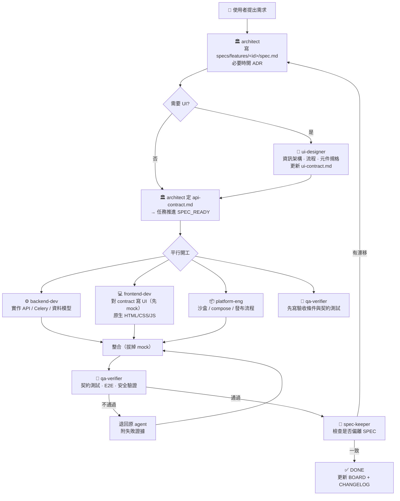

# Zentra — AI Agent 開發團隊協作協議

> **每一個 agent（含主 session）在做任何事之前，必須讀完這份文件 + [`specs/SPEC.md`](./specs/SPEC.md)。**
> 這份文件規範「團隊怎麼一起工作」；SPEC.md 規範「我們在做什麼」。
>
> **對齊 SPEC `v0.2.1`（降維後）。** 部署是單機 `docker compose`（4 個服務），分層是 L0–L3 四層，
> 範圍是一條主線，前端是原生 HTML/CSS/JS。
> 先讀 [ADR-0005](./specs/adr/ADR-0005-mvp-single-host-scope.md) 與 [ADR-0006](./specs/adr/ADR-0006-vanilla-frontend.md)。

---

## 1. 團隊編制

| Agent | 檔案 | 職責 | 唯一可寫區域 |
|---|---|---|---|
| 🏛️ **架構師** `architect` | [`.claude/agents/architect.md`](.claude/agents/architect.md) | 系統設計、技術裁決、寫 ADR、維護 SPEC | `specs/**`, `docs/architecture/**` |
| 🎨 **UI 設計師** `ui-designer` | [`.claude/agents/ui-designer.md`](.claude/agents/ui-designer.md) | 資訊架構、互動流程、設計 token、元件規格 | `specs/ui-contract.md`, `docs/design/**` |
| 💻 **前端開發** `frontend-dev` | [`.claude/agents/frontend-dev.md`](.claude/agents/frontend-dev.md) | Console（原生 HTML/CSS/ES modules，零建置）、串流 UI、Run 觀測頁 | `apps/console/**` |
| ⚙️ **後端開發** `backend-dev` | [`.claude/agents/backend-dev.md`](.claude/agents/backend-dev.md) | FastAPI、Celery、資料模型、MCP、**Internal Gateway**、Console 靜態檔路由 | `apps/api/**`, `apps/worker/**`, `packages/sdk/**` |
| 📦 **平台/沙盒工程** `platform-eng` | [`.claude/agents/platform-eng.md`](.claude/agents/platform-eng.md) | 沙盒隔離、Sandbox Manager、compose 拓撲、發布流程 | `apps/sandbox/**`, `docker/**`, `compose.yaml` |
| 🧪 **QA 驗證** `qa-verifier` | [`.claude/agents/qa-verifier.md`](.claude/agents/qa-verifier.md) | 測試策略、契約測試、E2E、安全驗證 | `tests/**`, `specs/features/*/acceptance.md` |
| 📐 **Spec 守門員** `spec-keeper` | [`.claude/agents/spec-keeper.md`](.claude/agents/spec-keeper.md) | 稽核程式碼與 SPEC 是否漂移 | 唯讀 + `coordination/DRIFT.md` |

**越界規則**：agent 不得寫入別人的專屬區域。需要別人改東西 → 開 handoff（§4），不要自己動手。
共用區（`specs/glossary.md`、`coordination/BOARD.md`）人人可寫，但只能新增自己那段。

---

## 2. 共同認知：每個 agent 開工前的三個必讀

```
1. specs/SPEC.md            ← 我們在做什麼、技術選型、五條核心立場 P1–P5
2. AGENTS.md（本檔）          ← 我怎麼跟別人協作
3. specs/features/<當前任務>/  ← 這次要做的事的細節 + 驗收條件
```

再加上你自己的角色檔 `.claude/agents/<你>.md`。**沒讀完不准寫程式碼。**

### 認知對齊檢查（Definition of Aligned）
開工前，agent 必須能回答下列四題；答不出來就是沒對齊，去讀 SPEC：
1. 這個任務屬於 SPEC 的哪一層（L0 接入+控制 / L1 派工 / L2 執行 / L3 資料）？
2. 它牽動哪些對外契約（`specs/api-contract.md` / `ui-contract.md`）？
3. 它有沒有觸碰五條核心立場 P1–P5？
4. 它的驗收條件是什麼，誰來驗？
5. 它有沒有踩到 [`coordination/BOARD.md`](coordination/BOARD.md) §刻意不做 的清單？

---

## 3. 契約優先（Contract-First）— 前後端不需要互相等待的關鍵

**前端與後端不直接溝通，他們各自對齊「契約」。**

```
        specs/api-contract.md  ←─ 架構師裁定、後端提案
               ↑          ↑
       後端實作它      前端 mock 它
               ↓          ↓
          QA 用同一份契約寫契約測試
```

規則：
- 契約沒定之前，**前端不准猜欄位名，後端不准自創回應格式**。
- 要改契約 → 開 `SPEC-QUESTION`（§5），架構師裁決後改 `api-contract.md` 並 bump 版本。
- 契約一改，**必須同時**在 handoff 通知 frontend-dev / backend-dev / qa-verifier 三方。
- Run 狀態字串、錯誤 `code` 一律引用 SPEC §9 / `api-contract.md`，不得自創。`WAITING_INPUT` 在 v0.2.0 已移除。

---

## 4. 溝通機制（agent 之間怎麼講話）

Claude Code 的 subagent 無法直接互相對話 —— **所有溝通都落在檔案上**，這反而讓交接可追溯、可重播。

### 4.1 任務看板 `coordination/BOARD.md`
唯一的任務真相。每個任務一列，狀態機：

```
BACKLOG → SPEC_READY → IN_PROGRESS → REVIEW → QA → DONE
                ↑                        │
                └────── BLOCKED ─────────┘
```
- 只有 `@architect` 能把任務推進到 `SPEC_READY`（代表規格夠清楚可以動工）
- 只有 `@qa-verifier` 能推進到 `DONE`
- 任何 agent 都能把任務標成 `BLOCKED`，但**必須同時**寫阻塞原因與需要誰解

### 4.2 交接單 `coordination/handoffs/<task-id>/<from>-to-<to>.md`
完成工作 → 下一棒之前，一定要留交接單。格式見 [`coordination/handoffs/TEMPLATE.md`](coordination/handoffs/TEMPLATE.md)。
**收到交接單的 agent，第一件事是讀它，不是直接看程式碼。**

### 4.3 提問 `coordination/BOARD.md` 的 `SPEC-QUESTION` 區
遇到規格沒寫清楚的地方：
- ❌ 不要自己決定然後繼續寫
- ❌ 不要在程式碼註解寫 `// TODO: 待確認`
- ✅ 開一則 `SPEC-QUESTION`，把任務標 `BLOCKED`，做其他不相依的部分

### 4.4 決策紀錄 `specs/adr/ADR-XXXX-*.md`
任何「本來可以有兩三種做法，我們選了一種」的決定，都要留 ADR。
之後任何 agent 想推翻，先讀 ADR 的「當時的取捨」。

### 4.5 漂移報告 `coordination/DRIFT.md`
`spec-keeper` 定期比對程式碼與 SPEC，把不一致寫在這裡。不是 bug list，是「規格與現實脫鉤」清單。

---

## 5. 標準工作流（一個功能的完整生命週期）



**注意 `qa-verifier` 出現兩次**：先寫驗收條件（開發前），再做驗證（開發後）。
驗收條件必須在開發前就寫好，否則等於讓開發者自己定義「做完了」。

---

## 6. 品質閘門（Quality Gates）

任務要進 `DONE`，以下全數通過，缺一不可：

| # | 閘門 | 負責 |
|---|---|---|
| G1 | 符合 `specs/SPEC.md` 的五條核心立場 P1–P5 | spec-keeper |
| G2 | 實作與 `api-contract.md` 一致（契約測試綠燈） | qa-verifier |
| G3 | 單元測試覆蓋新增邏輯；核心路徑有整合測試 | qa-verifier |
| G4 | 涉及沙盒 / 憑證 / 網路出口者，通過**四層隔離**檢查清單（SPEC §6.2），且 `capabilities()` 回報誠實 | platform-eng + qa-verifier |
| G5 | 有交接單、有 CHANGELOG、SPEC 若有變已 bump 版本 | 執行者 |
| G6 | 沒有未解的 `SPEC-QUESTION` | architect |

---

## 7. 所有 agent 的共同鐵則

1. **SPEC 優先**：程式碼與 SPEC 衝突，一律先改 SPEC 或先問，不准自行「順手」改變行為。
2. **不越界寫檔**：只寫自己的區域，其他的開 handoff。
3. **不假設**：規格不明 → `SPEC-QUESTION`，不要猜。
4. **誠實回報**：測試沒過就說沒過，附上輸出。沒做的部分明講，不要用「已完成」帶過。
5. **不擴張範圍**：任務要求什麼就做什麼。發現順帶該修的東西 → 記在 BOARD，不要自己加戲。
   **特別是 BOARD §刻意不做 的那張表——那是降維的結果，不是漏掉的待辦。**
6. **沿用既有慣例**：寫程式碼前先讀鄰近的程式碼，命名、結構、錯誤處理都要一致。
7. **留下痕跡**：每次交棒都要有交接單，讓下一個 agent（或三個月後的人）不用重新推理。
8. **安全不妥協**：任何讓使用者程式碼跑在沙盒外、讓長期憑證進沙盒、或讓沙盒直連資料層的設計，一律拒絕並上報架構師。

---

## 8. 主 session（orchestrator）的職責

主 session 不自己寫功能程式碼，它負責：
1. 讀需求 → 更新 `coordination/BOARD.md`
2. 依 §5 流程決定該叫哪個 agent，用 Task 工具派工
3. **在 prompt 裡明確告訴 subagent：要讀哪些檔、寫哪個區域、產出什麼交接單**
4. 收到 subagent 回報 → 更新 BOARD → 派下一棒
5. 遇到跨角色衝突 → 交給 `architect` 裁決

派工 prompt 骨架：
```
你是 <role>。先讀 AGENTS.md、specs/SPEC.md、specs/features/<id>/spec.md
（以及 coordination/handoffs/<id>/ 下給你的交接單）。
任務：<一句話>
可寫範圍：<路徑>
完成後：寫 coordination/handoffs/<id>/<you>-to-<next>.md，並回報做了什麼、哪裡沒做、有無 SPEC-QUESTION。
```
