<div align="center">

# Zentra

**An agent platform where every agent runs in an isolated sandbox and ships with both a REST API and an MCP endpoint.**

[繁體中文](#繁體中文) · [Architecture](docs/architecture/detailed-architecture.md) · [Spec](specs/SPEC.md) · [ADRs](specs/adr/)

</div>

---

Zentra lets you upload your own Python agent (LangGraph), freezes it into an immutable version, runs it inside an
isolated sandbox, and automatically publishes it behind **two front doors: a REST API and an MCP endpoint** —
generated from a single definition so they can never drift apart.

> **Status: design phase.** The architecture, specifications and agent-team workflow are complete.
> Implementation starts at [`ZEN-000`](specs/features/ZEN-000/spec.md). No application code yet.
>
> **Scoped down in [ADR-0005](specs/adr/ADR-0005-mvp-single-host-scope.md):** internal tool, single tenant,
> trusted code, 8-week MVP. Deployment is **one host running `docker compose`** — no Kubernetes.
> The console is **plain HTML + CSS + ES modules with no build step**
> ([ADR-0006](specs/adr/ADR-0006-vanilla-frontend.md)), served by the API itself — **four services total**.
> The five commitments below are unchanged; the infrastructure under them is a quarter of the size.

## Why this exists

Running user code is the hard part of any agent platform. Most of the design work here goes into one question: **what stops an uploaded agent from touching platform credentials, reaching the data layer, or calling out to the internet?**

The answer is five commitments that the rest of the architecture follows from.
ADR-0005 relaxed the *threat model* to trusted code — **it did not relax these five.**

| | Commitment |
|---|---|
| **P1** | User code **never executes inside a platform process**. Celery workers only dispatch and observe — every `exec` happens in a sandbox. |
| **P2** | Agents are **always LangChain + LangGraph**. One framework means streaming, event hooks and tracing are written once. |
| **P3** | Every agent gets **both an API and an MCP interface**, generated from the same `entrypoints` definition. |
| **P4** | **No long-lived credential ever enters a sandbox.** The sandbox network has no route out; its only peer is an **Internal Gateway** that holds the secrets. |
| **P5** | **Published versions are immutable.** `agent@semver` is identified by the bundle's SHA-256; its directories are frozen read-only on publish. |

## Architecture



One host, one `docker compose`, four long-running services — plus a sandbox container created per Run and destroyed
when it ends. The sandbox sits on a network with **no route out**; its only peer is the `api` service's Internal
Gateway, which holds the LLM key, meters tokens and collects events. The console has no container of its own: it is
static HTML/CSS/JS served by `api`, calling the same `/v1` API everyone else calls.

```
L0  Access + Control   api (FastAPI) — REST · MCP · SSE · Console static files · Registry · Internal Gateway
L1  Dispatch           worker (Celery, Redis broker) — q.run · q.build
L2  Execution          Sandbox Manager → Sandbox (Docker, one per Run)
L3  Data               PostgreSQL · Redis · local volume (bundles / venvs)
```

**[→ 11 detailed diagrams](docs/architecture/detailed-architecture.md)** covering the publish flow, request lifecycle, sandbox isolation model, Celery topology, agent runtime, data model and deployment.

### The two hard parts

**Sandbox isolation** ([ADR-0001](specs/adr/ADR-0001-sandbox-isolation.md), scoped by [ADR-0005](specs/adr/ADR-0005-mvp-single-host-scope.md)) — four Docker-native layers, on the assumption that each one can be breached: an internal-only network, dropped capabilities and a non-root user, cgroup limits, and a read-only filesystem, plus an SDK interception layer. Sandboxes are never reused across runs. **There is no gVisor**, so `capabilities()` reports `l2_kernel_isolation: false` and the matching security tests are marked `skipped`, never `passed` — this tier fits trusted code, not a public multi-tenant platform.

**Celery ↔ LangGraph boundary** ([ADR-0002](specs/adr/ADR-0002-celery-langgraph-boundary.md)) — one rule: *crosses machines, needs queueing, or scales independently → Celery; just the next step inside one agent → a LangGraph node.* One run is one Celery task, however many nodes the graph has.

## Repository layout

| Path | What's in it |
|---|---|
| [`specs/`](specs/) | **Single source of truth.** Master spec, API & UI contracts, glossary, ADRs, feature specs |
| [`docs/architecture/`](docs/architecture/) | Mermaid diagrams and design deep-dives |
| [`coordination/`](coordination/) | Task board, handoff notes, spec-drift audits |
| [`.claude/agents/`](.claude/agents/) | Seven role agents — architect, UI, frontend, backend, platform, QA, spec-keeper |
| [`.claude/commands/`](.claude/commands/) | `/align` `/task` `/handoff` `/verify` `/drift` |
| [`.codex/agents/`](.codex/agents/) | Seven matching Codex roles, sharing the same project spec |
| [`.agents/skills/`](.agents/skills/) | Codex workflows: align, task, handoff, verify, drift |
| [`docs/codex.md`](docs/codex.md) | Codex setup, invocation examples, and collaboration limits |

## Built by a team of AI agents

This repository supports Claude Code and Codex role agents. Durable decisions and handoffs are recorded in shared files; available agent messaging tools can help coordinate the work:

- **One spec** everyone reads before starting ([`specs/SPEC.md`](specs/SPEC.md))
- **Contract-first** — frontend and backend both target [`api-contract.md`](specs/api-contract.md) instead of waiting on each other
- **Handoff notes** and a [task board](coordination/BOARD.md) carry state between roles
- **A spec-keeper agent** audits the code for drift away from the spec

The protocol is written up in [`AGENTS.md`](AGENTS.md).

## Stack

Python 3.12 · FastAPI · Celery (Redis broker) · LangChain + LangGraph · PostgreSQL · Redis · Docker · plain HTML/CSS/JS (no build step)

## Getting started

Implementation hasn't begun. To understand the project:

1. [`specs/SPEC.md`](specs/SPEC.md) — what it is and the five commitments
2. [`docs/architecture/detailed-architecture.md`](docs/architecture/detailed-architecture.md) — how it fits together
3. [`specs/adr/`](specs/adr/) — why it's built this way rather than some other way
4. [`specs/features/ZEN-000/spec.md`](specs/features/ZEN-000/spec.md) — the first task

Local and production are the same `docker compose` stack — there is no separate deployment target. See
[ADR-0005](specs/adr/ADR-0005-mvp-single-host-scope.md) for what was cut and why, and the
[runtime notes](docs/architecture/07-local-dev-sandbox.md) for how sandboxes are actually launched.

---

<a name="繁體中文"></a>

## 繁體中文

**Zentra 是一個 Agent 平台**：開發者上傳自己的 Python 程式碼（LangGraph），
平台把它凍結成不可變版本、在**隔離沙盒**中執行，並自動對外開放 **REST API** 與 **MCP** 兩種接口——
兩者由同一份 `entrypoints` 定義生成，因此永遠不會不一致。

> **目前狀態：設計階段。** 架構、規格與 AI agent 團隊協作流程已完成。
> 實作從 [`ZEN-000`](specs/features/ZEN-000/spec.md) 開始，尚無應用程式碼。
>
> **已依 [ADR-0005](specs/adr/ADR-0005-mvp-single-host-scope.md) 降維：** 內部工具、單租戶、信任的程式碼、八週 MVP。
> 部署是**一台主機跑 `docker compose`**，不用 Kubernetes。
> 前端再依 [ADR-0006](specs/adr/ADR-0006-vanilla-frontend.md) 改為**原生 HTML + CSS + ES modules，零建置**，
> 由 API 自己服務 —— **總共四個服務**。
> 下面五條立場一條沒動，但底下的基礎設施只剩四分之一。

### 為什麼這樣設計

執行使用者程式碼是 Agent 平台最難的部分。整份設計都在回答一個問題：
**要怎麼確保上傳的 Agent 摸不到平台憑證、碰不到資料層、打不了外網？**

答案是五條核心立場，其餘架構都是它們的推論：
（威脅模型隨 ADR-0005 降級為「信任的程式碼」，但**這五條沒有跟著降**）

| | 立場 |
|---|---|
| **P1** | 使用者程式碼**永遠不在平台行程內執行**。Celery worker 只派工與監看，`exec` 一律在沙盒。 |
| **P2** | Agent 框架**統一 LangChain + LangGraph**。收斂成一種，串流、事件 hook、觀測才只要寫一次。 |
| **P3** | 每個 Agent **天生就有 API + MCP 兩個門面**，由同一份定義生成。 |
| **P4** | **沙盒內拿不到任何長期憑證**。沙盒網段沒有對外路由，唯一對端是代持憑證的 **Internal Gateway**。 |
| **P5** | **發布的版本不可變**。`agent@semver` 以 bundle 的 SHA-256 識別，發布後目錄設唯讀。 |

### 架構圖


一台主機、一個 `docker compose`、**四個**長駐服務（postgres · redis · api · worker），
加上**每個 Run 動態建立、結束即銷毀**的沙盒容器。
沙盒掛在一個**沒有對外路由**的網段上，唯一的對端是 `api` 服務的 **Internal Gateway**——
由它代持 LLM 金鑰、計量 token、回收事件。
Console 沒有自己的容器，它是 `api` 服務出去的原生靜態檔，打的是跟外部系統同一份 `/v1` API。
圖中標注各層的技術與關鍵參數（佇列、隔離層級、資源上限）。

### 兩個技術核心

**沙盒隔離**（[ADR-0001](specs/adr/ADR-0001-sandbox-isolation.md)，範圍見 [ADR-0005](specs/adr/ADR-0005-mvp-single-host-scope.md)）——
四層 Docker 原生隔離，且**假設每一層都可能被突破**：internal 網段、`cap_drop ALL` + non-root、cgroups 限額、唯讀檔案系統，外加 SDK 攔截層。沙盒一 Run 一盒，絕不重用。
**沒有 gVisor**——`capabilities()` 誠實回報 `l2_kernel_isolation: false`，對應的安全測試標 `skipped` 而非 `passed`。
這個等級適用於**信任的程式碼**，不適用於公開多租戶。

**Celery 與 LangGraph 的邊界**（[ADR-0002](specs/adr/ADR-0002-celery-langgraph-boundary.md)）——
一條判準：*跨機器、需排隊、需獨立擴縮 → Celery；只是同一 Agent 內部的下一步 → LangGraph node。*
一次 Run 就是一個 Celery task，不管圖裡有幾個節點。

### 由 AI agent 團隊協作開發

這個 repo 支援 Claude Code 與 Codex 的角色分工。
可用的 agent 訊息工具協助討論，決策與交接仍寫入共用檔案：

- **一份共同規格**，所有人開工前必讀（[`specs/SPEC.md`](specs/SPEC.md)）
- **契約優先**——前後端各自對齊 [`api-contract.md`](specs/api-contract.md)，不用互相等待
- **交接單**與[任務看板](coordination/BOARD.md)串起角色之間的狀態
- **spec-keeper agent** 定期稽核程式碼是否偏離規格

完整協議見 [`AGENTS.md`](AGENTS.md)。
Codex 的角色、skills 與操作範例見 [`docs/codex.md`](docs/codex.md)，可先輸入 `$zentra-align ZEN-000` 對齊現況。

### 從哪裡開始讀

1. [`specs/SPEC.md`](specs/SPEC.md) — 這是什麼、五條核心立場
2. [`docs/architecture/detailed-architecture.md`](docs/architecture/detailed-architecture.md) — 11 張架構圖
3. [`specs/adr/`](specs/adr/) — 為什麼這樣做，而不是別的做法（**先讀 [ADR-0005](specs/adr/ADR-0005-mvp-single-host-scope.md)**，它說明砍了什麼）
4. [`specs/features/ZEN-000/spec.md`](specs/features/ZEN-000/spec.md) — 第一個任務

---

## License

_License not yet chosen._
