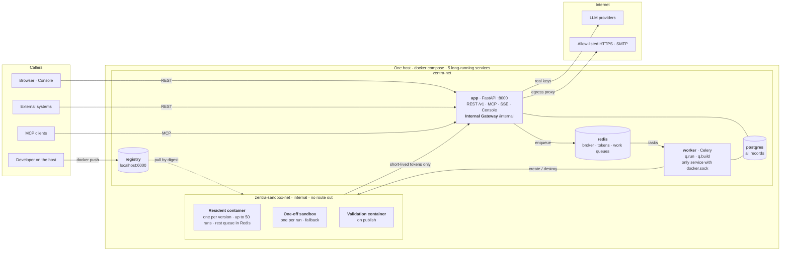
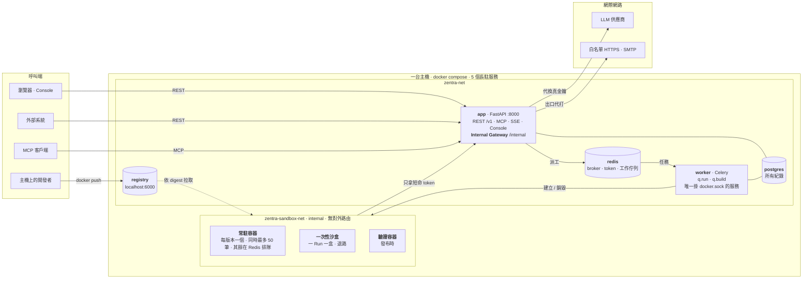

<div align="center">

# Zentra

**An agent platform where every agent runs in an isolated sandbox and ships with both a REST API and an MCP endpoint.**

[繁體中文](#繁體中文) · [Specs](specs/overview.md)

</div>

---

Zentra lets you upload your own Python agent (LangGraph), freezes it into an immutable version, runs it inside an
isolated sandbox, and automatically publishes it behind **two front doors: a REST API and an MCP endpoint** —
generated from a single definition so they can never drift apart.

> **Status: under implementation.** The walking skeleton runs end to end — upload-free builtin agent,
> OCI image registration, sandboxed execution, REST + MCP and the Run observation console. Nothing has been
> accepted as `DONE` beyond the console slice; [`coordination/BOARD.md`](coordination/BOARD.md) is the
> authority on what is verified and what is still open.
>
> **Scoped down in [ADR-0005](specs/overview.md):** internal tool, single tenant,
> trusted code, 8-week MVP. Deployment is **one host running `docker compose`** — no Kubernetes.
> The console is **plain HTML + CSS + ES modules with no build step**
> ([ADR-0006](specs/console-ui.md)), served by the API itself — **four services total**.
> The five commitments below are unchanged; the infrastructure under them is a quarter of the size.

## Why this exists

Running user code is the hard part of any agent platform. Most of the design work here goes into one question: **what stops an uploaded agent from touching platform credentials, reaching the data layer, or calling out to the internet?**

The answer is five commitments that the rest of the architecture follows from.
ADR-0005 relaxed the *threat model* to trusted code — **it did not relax these five.**

| | Commitment |
|---|---|
| **P1** | User code **never executes inside a platform process**. Celery workers only dispatch and observe — every `exec` happens in a sandbox. |
| **P2** | Agents are **always LangChain + LangGraph**. One framework means streaming, event hooks and tracing are written once. |
| **P3** | Every agent gets **both an API and an MCP interface**, generated from the same `entrypoints` definition. |
| **P4** | **No long-lived credential ever enters a sandbox.** The sandbox network has no route out; its only peer is an **Internal Gateway** that holds the secrets. |
| **P5** | **Versions are immutable.** Identified by the full OCI digest; a version record's digest is never rewritten, and re-registering a semver adds a new record that replaces the old one. |

## Architecture


One host, one `docker compose`, five long-running services — plus Agent containers the worker creates on demand:
by default one **resident container** per version that runs many runs at once and is reclaimed when idle, with a
**one-off sandbox per run** as the fallback. Containers sit on a network with **no route out**; their only peer is the
`app` service's Internal Gateway, which holds the LLM keys, meters tokens and proxies allow-listed egress. The console
has no container of its own: it is static HTML/CSS/JS served by `app`, calling the same `/v1` API everyone else calls.



Every arrow out of the sandbox network goes to `app` — no route to postgres, redis, the registry or the internet.
Long-lived credentials stay on `app`; containers only get short-lived tokens. Details: [`specs/overview.md`](specs/overview.md).

```
L0  Access + Control   api (FastAPI) — REST · MCP · SSE · Console static files · Registry · Internal Gateway
L1  Dispatch           worker (Celery, Redis broker) — q.run · q.build
L2  Execution          resident Agent container per version (default) · one-off sandbox per Run (fallback)
L3  Data               PostgreSQL · Redis · internal OCI registry · Docker image cache
```


### The two hard parts

**Sandbox isolation** ([ADR-0001](specs/container-orchestration.md), scoped by [ADR-0005](specs/overview.md)) — four Docker-native layers, on the assumption that each one can be breached: an internal-only network, dropped capabilities and a non-root user, cgroup limits, and a read-only filesystem. A resident container is bound to one version and serves only that agent's runs. **There is no gVisor**, so `capabilities()` reports `l2_kernel_isolation: false` and the matching security tests are marked `skipped`, never `passed` — this tier fits trusted code, not a public multi-tenant platform.

**Celery ↔ LangGraph boundary** ([ADR-0002](specs/dispatch.md)) — one rule: *crosses machines, needs queueing, or scales independently → Celery; just the next step inside one agent → a LangGraph node.* One run is one Celery task, however many nodes the graph has.

## Repository layout

| Path | What's in it |
|---|---|
| [`examples/my-agent/`](examples/my-agent/) | **Start here to write an agent.** A working text-analysis agent — copy the directory, edit `agent.py` |
| [`examples/llm-agent/`](examples/llm-agent/) | The same thing but calling a model through `ctx.llm()`, with the credential staying on the platform |
| [`examples/stock-agent/`](examples/stock-agent/) | A bounded retry loop: search, judge whether the answer is there, search again with what was missing |
| [`specs/`](specs/) | **Single source of truth.** Eleven files, one per subsystem; start at `overview.md` |
| [`coordination/BOARD.md`](coordination/BOARD.md) | Open tasks, known defects, and what is deliberately out of scope |
| [`.claude/`](.claude/) | One `builder` agent and a `/verify` command for Claude Code |

## Built with Claude Code

Development rules live in [`CLAUDE.md`](CLAUDE.md), kept deliberately short: the five commitments,
where to read the spec, and a verification rule — run the changed path for real, and add the smoke test and
isolation checklist only when the sandbox, credentials or network egress change. Frontend and backend
both target [`specs/api.md`](specs/api.md) (contract-first).

## Stack

Python 3.12 · FastAPI · Celery (Redis broker) · LangChain + LangGraph · PostgreSQL · Redis · Docker · plain HTML/CSS/JS (no build step)

## Getting started

To understand the project:

1. [`specs/overview.md`](specs/overview.md) — what it is, the five commitments, and a map of the other spec files
2. [`coordination/BOARD.md`](coordination/BOARD.md) — what is actually built, what is still open

Local and production are the same `docker compose` stack — there is no separate deployment target. See
[ADR-0005](specs/overview.md) for what was cut and why, and the
[runtime notes](specs/container-orchestration.md) for how sandboxes are actually launched.

## Running the stack

```bash
make up          # everything below, then checks the stack answered
make help        # every target
```

`make` is a convenience wrapper with no product behaviour of its own; the commands it runs are these:

```bash
docker compose up -d --build                     # postgres · redis · registry · api · worker
docker build -t zentra/agent-base:1.0 -f docker/agent-base.Dockerfile .
make migrate
```

Two things compose does **not** do for you:

- **The base image.** `zentra/agent-base:1.0` is what your own agent images build `FROM`. It belongs to
  no compose service — nothing runs it — so compose has no place to build it from. Rebuild it after a
  change under `packages/sdk/`; images already published are unaffected, since their contents are frozen.
- **Migrations.** Nothing migrates at startup. Existing databases: first
  `bash scripts/adopt-legacy-schema.sh --dry-run`, confirm, run it again without
  `--dry-run`, then `make migrate`.

A **Run uses the agent's own image**, pulled by the digest registered for that version. There is no
shared runtime container in that path. The one exception is the built-in `builtin-echo` fixture left over
from ZEN-000, which still runs from `zentra/agent-runtime:dev` (`SANDBOX_IMAGE`) and is what the smoke
test below exercises. Build it only if you intend to run that script:

```bash
docker build -t zentra/agent-runtime:dev -f docker/agent-runtime.Dockerfile .
```

Retiring that fixture is [tracked on the board](coordination/BOARD.md); it is load-bearing for the smoke
test and nine test files, so it is a task of its own rather than a deletion.

The registry publishes on **host port 6000**, not the 5000 registries usually take: macOS runs AirPlay
Receiver on `*:5000`, which shadows it. Inside the container it is still 5000 — only the host side moved
([ADR-0009](specs/agent-registry.md) R3). Check it with the header, not just
reachability, since anything else on that port would also answer:

```bash
curl -sI http://127.0.0.1:6000/v2/ | grep -i docker-distribution-api-version
```

Both networks — including the internal-only `zentra-sandbox-net` — are declared in `compose.yaml`, so no
`docker network create` is needed. `.env` is optional; nothing in the current scope requires a secret.

```bash
curl -s localhost:8000/healthz                   # {"status":"ok"}
open http://localhost:8000/console/agents        # Console
```

The API image carries the console's static files, so **a console change needs
`docker compose up -d --build app`** before the browser can see it.

## Ship an agent

The whole loop, end to end. Every command below was run against this stack.

The fastest start is the working example in [`examples/my-agent/`](examples/my-agent/) — a text
analysis agent with real branching, not a hello world. Copy that directory and edit `agent.py`.

Start from a running stack — `make up`, above. The commands here are plain `docker` and `curl` on
purpose: they are what *you* do to *your* agent, and they are the same whether you drive them by hand, from
a script, or from CI. `make` only wraps the platform's own chores. The one you will want while working on
an agent is `make rebuild-api`, after editing anything under `apps/console/`.

### 1. Write `agent.py`

```python
from typing import TypedDict
from langgraph.graph import END, START, StateGraph
from zentra_sdk import agent

class State(TypedDict, total=False):
    question: str
    answer: str

@agent(
    name="my-agent",
    version="1.0.0",
    entrypoints=[{
        "name": "default",
        "description": "What this entrypoint does",
        "input_schema":  {"type": "object", "required": ["question"],
                          "properties": {"question": {"type": "string"}}},
        "output_schema": {"type": "object", "required": ["answer"],
                          "properties": {"answer": {"type": "string"}}},
    }],
)
def build(ctx) -> StateGraph:
    graph = StateGraph(State)

    async def node(state: State) -> dict:
        return {"answer": f"got: {state['question']}"}

    graph.add_node("node", node)
    graph.add_edge(START, "node")
    graph.add_edge("node", END)
    return graph
```

`entrypoints` is the only schema source there is. REST input validation, the MCP `tools/list` response
and the per-agent OpenAPI document are all generated from it (P3), so changing it means publishing a new
version.

The module must be importable as `agent` — the filename can differ, the module name cannot
([ADR-0003](specs/agent-registry.md)).

### 2. Write the Dockerfile

```dockerfile
FROM zentra/agent-base:1.0
COPY agent.py /opt/zentra/app/agent.py
```

The base image already carries the SDK, its dependencies, the `io.zentra.image-contract` label and
uid 65534. Writing the Dockerfile by hand instead is fine — see
[`examples/demo-echo/Dockerfile`](examples/demo-echo/Dockerfile), which spells out every contract
requirement — but then the dependencies are yours to get right.

### 3. Build and push

**The build context is your agent's own directory, so `cd` into it first.** `.` means "look for the
Dockerfile and everything it copies right here", and a Dockerfile that only copies `agent.py` needs
nothing else in scope:

```bash
cd examples/my-agent        # or wherever your agent lives
docker build -t localhost:6000/my-agent:1.0.0 .
docker push  localhost:6000/my-agent:1.0.0
```

Your agent's directory does not have to live inside this repository. Its only tie to the platform is
`FROM zentra/agent-base:1.0`, an image already on your machine.

Then ask Docker for the reference to register. **Do not paste the push output** — it prints
`1.0.0: digest: sha256:… size: …`, which is the digest alone, without the repository in front of it.
This command prints the whole thing, ready to paste:

```bash
docker inspect --format='{{index .RepoDigests 0}}' localhost:6000/my-agent:1.0.0
# → localhost:6000/my-agent@sha256:58b16bb2…
```

That digest is the **registry manifest digest**. The sha256 `docker build` prints is the local image ID,
a different identifier that cannot stand in for it.

Tag with the semver you are about to register. Nothing enforces it, but it keeps every registered
manifest reachable by a tag, which matters for the garbage-collection trap in
[`specs/dispatcher-resources.md`](specs/dispatcher-resources.md).

An external registry (GHCR, Docker Hub, your own) works exactly the same way. The platform does not care
which one, only that it can pull the digest.

### 4. Create the Agent and register the version

In the Console at `http://localhost:8000/console/agents`, or over the API:

```bash
AID=$(curl -s -X POST http://localhost:8000/v1/agents   -H 'Content-Type: application/json'   -d '{"name":"my-agent","description":"..."}' \
  | python3 -c 'import sys, json; print(json.load(sys.stdin)["agent_id"])')

curl -s -X POST "http://localhost:8000/v1/agents/$AID/versions"   -H 'Content-Type: application/json'   -d "{\"semver\":\"1.0.0\",\"image_ref\":\"localhost:6000/my-agent@sha256:58b16bb2…\"}"
```

The response is `BUILDING`. In the background the platform pulls the image by digest, inspects it, and
runs `zentra-agent validate` **inside a throwaway sandbox** to extract the entrypoint schemas — user code
is never imported by the platform (P1). Poll until it settles:

```bash
curl -s "http://localhost:8000/v1/agents/$AID/versions/1.0.0" | python3 -c 'import sys, json; print(json.load(sys.stdin)["status"])'
```

`PUBLISHED` means it is runnable. `FAILED` puts the validation container's full traceback in
`error.message`; that is the only debugging signal you get, so read it rather than guessing.

Only digests are accepted. A tag is rejected with `VALIDATION_ERROR`, and re-registering a semver that
already exists replaces it once the new image validates (a `409` only while that semver is still validating).

### 5. Run it

```bash
# REST, synchronous, 60s ceiling
curl -s -X POST "http://localhost:8000/v1/agents/$AID/runs:invoke" \
  -H 'Content-Type: application/json' \
  -d '{"entrypoint":"default","input":{"question":"hello"}}'

# Asynchronous, with the event stream
RID=$(curl -s -X POST "http://localhost:8000/v1/agents/$AID/runs" \
  -H 'Content-Type: application/json' \
  -d '{"entrypoint":"default","input":{"question":"hello"}}' \
  | python3 -c 'import sys, json; print(json.load(sys.stdin)["run_id"])')
curl -sN "http://localhost:8000/v1/runs/$RID/events"

# MCP — same agent, same schema, generated from the same entrypoints
curl -s -X POST "http://localhost:8000/mcp/agents/$AID" \
  -H 'Content-Type: application/json' \
  -H 'Accept: application/json, text/event-stream' \
  -d '{"jsonrpc":"2.0","id":1,"method":"tools/call",
       "params":{"name":"default","arguments":{"question":"hello"}}}'
```

The stream runs `QUEUED → SCHEDULING → RUNNING → node.start → node.end → SUCCEEDED`. Each Run gets its own
sandbox container, which is destroyed when the Run ends and never reused.

### Three ways to get it wrong

All three surface as `BUILD_FAILED` with the traceback in `error.message`:

| Mistake | What happens |
|---|---|
| `def build()` | Rejected by an arity check that names the signature the contract wants. `build` takes the context. |
| Returning a `.compile()`d graph | The platform compiles it itself to inject the event hooks. Compile it yourself and the Run observation page has no `node.start` / `node.end` to show. |
| A hand-written Dockerfile missing `jsonschema` | A startup check names what is missing. The base image avoids this. |

### What the sandbox deliberately does not have

Do not look for these in your agent — their absence is the point (P4):

- Any API key, LLM credential or registry credential
- PostgreSQL or Redis
- Outbound network

The sandbox sits on a network with no route out; its only peer is the platform's Internal Gateway, which
holds the credentials on its behalf. Calling a model goes through `ctx.llm()`, which returns an ordinary
`ChatOpenAI` pointed at the Gateway and authenticated with the Run's token. The provider key lives on the
`app` service and is swapped in there, so the sandbox never holds it. Every call is recorded in
`llm_calls`, and a Run's `usage` is computed from that table rather than taken from what the agent reports.
See [`examples/llm-agent/`](examples/llm-agent/).

You can use OpenAI's **models** this way. You cannot use OpenAI's **Agents SDK** to orchestrate: `build()`
must return an uncompiled `StateGraph`, and the runtime checks the type (P2). The reasoning and what
overturning it would cost is priced out in
[ADR-0010](specs/overview.md).

### Publishing a new version

Build, push, register. A new semver leaves the old version running untouched. Registering an existing
semver **replaces** it: the new image is validated first, and only if it passes does it take over — runs
already created keep the image they were bound to, and the old image is cleaned up once they finish.
See [`specs/agent-registry.md`](specs/agent-registry.md).

## Testing

### Smoke test: the ZEN-000 acceptance script

```bash
bash scripts/verify-zen000.sh
```

One end-to-end pass plus the isolation probes: SSE events, sandbox lifecycle, the four isolation layers, and
the contract error paths. Expect `通過 27 ／ 失敗 0 ／ 跳過 2`. The two skips are gVisor kernel isolation and
container escape — this architecture does not provide them, so they are reported as **skipped, never passed**
([ADR-0005](specs/overview.md)). Needs the stack up, migrations applied and the
runtime image built.

There is no automated test suite in the repo. Changes are verified by running the changed path on the real
stack (curl or the Console); changes to the sandbox, credentials or network egress also run the smoke test
above and the isolation checklist in [`.claude/commands/verify.md`](.claude/commands/verify.md).

---

<a name="繁體中文"></a>

## 繁體中文

**Zentra 是一個 Agent 平台**：開發者上傳自己的 Python 程式碼（LangGraph），
平台把它凍結成不可變版本、在**隔離沙盒**中執行，並自動對外開放 **REST API** 與 **MCP** 兩種接口——
兩者由同一份 `entrypoints` 定義生成，因此永遠不會不一致。

> **目前狀態：實作中。** 貫穿骨架已經跑得通——內建 Agent、OCI image 註冊、沙盒執行、
> REST + MCP，以及 Run 觀測 Console。除了 Console 切片之外**都還沒被驗收為 `DONE`**，
> 哪些驗過、哪些還開著，以 [`coordination/BOARD.md`](coordination/BOARD.md) 為準。
>
> **已依 [ADR-0005](specs/overview.md) 降維：** 內部工具、單租戶、信任的程式碼、八週 MVP。
> 部署是**一台主機跑 `docker compose`**，不用 Kubernetes。
> 前端再依 [ADR-0006](specs/console-ui.md) 改為**原生 HTML + CSS + ES modules，零建置**，
> 由 API 自己服務 —— compose 是**五個服務**（[ADR-0009](specs/agent-registry.md)
> 的內部 Registry 是第五個）。
> 下面五條立場一條沒動，但底下的基礎設施只剩四分之一。

### 為什麼這樣設計

執行使用者程式碼是 Agent 平台最難的部分。整份設計都在回答一個問題：
**要怎麼確保上傳的 Agent 摸不到平台憑證、碰不到資料層、打不了外網？**

答案是五條核心立場，其餘架構都是它們的推論：
（威脅模型隨 ADR-0005 降級為「信任的程式碼」，但**這五條沒有跟著降**）

| | 立場 |
|---|---|
| **P1** | 使用者程式碼**永遠不在平台行程內執行**。Celery worker 只派工與監看，`exec` 一律在沙盒。 |
| **P2** | Agent 框架**統一 LangChain + LangGraph**。收斂成一種，串流、事件 hook、觀測才只要寫一次。 |
| **P3** | 每個 Agent **天生就有 API + MCP 兩個門面**，由同一份定義生成。 |
| **P4** | **沙盒內拿不到任何長期憑證**。沙盒網段沒有對外路由，唯一對端是代持憑證的 **Internal Gateway**。 |
| **P5** | **版本不可變**。以完整 OCI digest 識別；一筆版本紀錄的 digest 永不改寫，同版號重新註冊是新增一筆並取代舊的。 |

### 架構

一台主機、一個 `docker compose`、**五個**長駐服務
（postgres · redis · registry · api · worker），
加上由 worker 動態建立的 Agent 容器：預設是每個版本一個**常駐容器**（同時跑多筆 Run、閒置自動回收），
起不來時退回**一 Run 一盒**的一次性沙盒。
沙盒掛在一個**沒有對外路由**的網段上，唯一的對端是 `app` 服務的 **Internal Gateway**——
由它代持 LLM 金鑰、計量 token、回收事件。
Console 沒有自己的容器，它是 `app` 服務出去的原生靜態檔，打的是跟外部系統同一份 `/v1` API。



沙盒網段往外的每一條線都只到 `app` —— 到 postgres、redis、registry、網際網路都沒有路由。
長期憑證只在 `app` 上，容器只拿短命 token。細節見 [`specs/overview.md`](specs/overview.md)。
完整說明見 [`specs/overview.md`](specs/overview.md)。

### 兩個技術核心

**沙盒隔離**（[ADR-0001](specs/container-orchestration.md)，範圍見 [ADR-0005](specs/overview.md)）——
四層 Docker 原生隔離，且**假設每一層都可能被突破**：internal 網段、`cap_drop ALL` + non-root、cgroups 限額、唯讀檔案系統，外加 SDK 攔截層。沙盒一 Run 一盒，絕不重用。
**沒有 gVisor**——`capabilities()` 誠實回報 `l2_kernel_isolation: false`，對應的安全測試標 `skipped` 而非 `passed`。
這個等級適用於**信任的程式碼**，不適用於公開多租戶。

**Celery 與 LangGraph 的邊界**（[ADR-0002](specs/dispatch.md)）——
一條判準：*跨機器、需排隊、需獨立擴縮 → Celery；只是同一 Agent 內部的下一步 → LangGraph node。*
一次 Run 就是一個 Celery task，不管圖裡有幾個節點。

### 用 Claude Code 開發

開發規則在 [`CLAUDE.md`](CLAUDE.md)，刻意保持很短：五條立場、規格去哪讀，以及一條測試規則 ——
改到的路徑要實際跑一次，動到沙盒、憑證或網路出口才加跑冒煙測試與隔離清單。
前後端各自對齊 [`specs/api.md`](specs/api.md)（契約優先）。

### 本機啟動與測試

本機與正式是同一套 compose，沒有第二種部署方式。

```bash
make up          # 下面那些全部做完，最後確認服務有回應
make help        # 看所有指令
```

`make` 只是把指令包起來，沒有任何產品行為。它跑的就是這些：

```bash
docker compose up -d --build                     # postgres · redis · registry · api · worker
docker build -t zentra/agent-base:1.0 -f docker/agent-base.Dockerfile .
make migrate

curl -s localhost:8000/healthz                   # {"status":"ok"}
open http://localhost:8000/console/agents        # Console
```

compose **不會**幫你做兩件事：

- **Base image。** `zentra/agent-base:1.0` 是你自己的 agent image 的 `FROM`。
  它不屬於任何 compose 服務（沒有東西會「跑」它），所以 compose 沒有地方可以 build 它。
  改過 `packages/sdk/` 就重 build 一次；已經發布的 image 不受影響，它們的內容早就凍住了。
- **migration。** 啟動時不會自動跑。既有資料庫：先
  `bash scripts/adopt-legacy-schema.sh --dry-run`，確認後再跑一次不帶 `--dry-run`，
  然後 `make migrate`。

**每個 Run 用的是 agent 自己的 image**，依該版本註冊的 digest 拉下來，這條路徑上沒有共用的 runtime 容器。
唯一的例外是 ZEN-000 留下的內建 fixture `builtin-echo`，它仍然跑 `zentra/agent-runtime:dev`
（`SANDBOX_IMAGE`），也就是下面那支冒煙測試跑的對象。**只有要跑那支腳本才需要 build 它**：

```bash
docker build -t zentra/agent-runtime:dev -f docker/agent-runtime.Dockerfile .
```

退休這個 fixture 已[記在 BOARD](coordination/BOARD.md)：它是冒煙測試與 9 個測試檔的承重結構，
是一個獨立任務，不是刪幾行就好。

Registry 發布在**主機 port 6000**，不是 registry 慣用的 5000：macOS 的 AirPlay Receiver
在 `*:5000` 聽，會蓋掉它。容器內仍是 5000，換的只有主機端
（[ADR-0009](specs/agent-registry.md) R3）。
確認要看 header 而不是「連得上」——別的服務也會回應：

```bash
curl -sI http://127.0.0.1:6000/v2/ | grep -i docker-distribution-api-version
```

維運細節見 [`specs/dispatcher-resources.md`](specs/dispatcher-resources.md)。

兩個網段（含 internal 的 `zentra-sandbox-net`）都寫在 `compose.yaml` 裡，不用手動 `docker network create`。
`.env` 是選用的。Console 的靜態檔包在 app 映像裡，所以**改前端要 `docker compose up -d --build app`** 才看得到。

### 發布一個 Agent

完整流程，每一行都在這套 stack 上實際跑過。

最快的起手式是 [`examples/my-agent/`](examples/my-agent/) 那個**真的會動**的範例 ——
一個有條件分支的文字分析 Agent，不是 hello world。複製那個目錄，改 `agent.py` 就是你的了。

前提是環境已經起來了 —— 上面的 `make up`。這一節刻意用原始的 `docker` 與 `curl` 指令：
它們是**你**對**你自己的 agent** 做的事，手動打、寫成腳本、或放進 CI 都是同一組。
`make` 包的是平台自己的雜事。開發 agent 期間會用到的是 `make rebuild-api` ——
改過 `apps/console/` 底下的東西之後要跑它。

#### 1. 寫 `agent.py`

```python
from typing import TypedDict
from langgraph.graph import END, START, StateGraph
from zentra_sdk import agent

class State(TypedDict, total=False):
    question: str
    answer: str

@agent(
    name="my-agent",
    version="1.0.0",
    entrypoints=[{
        "name": "default",
        "description": "這個 entrypoint 做什麼",
        "input_schema":  {"type": "object", "required": ["question"],
                          "properties": {"question": {"type": "string"}}},
        "output_schema": {"type": "object", "required": ["answer"],
                          "properties": {"answer": {"type": "string"}}},
    }],
)
def build(ctx) -> StateGraph:
    graph = StateGraph(State)

    async def node(state: State) -> dict:
        return {"answer": f"收到：{state['question']}"}

    graph.add_node("node", node)
    graph.add_edge(START, "node")
    graph.add_edge("node", END)
    return graph
```

`entrypoints` 是**唯一**的 schema 來源：REST 的輸入驗證、MCP 的 `tools/list`、per-agent 的 OpenAPI
全部從它生成（P3）。改了它就要發新版本。

模組必須能以 `agent` 這個名字被 import ——
檔名可以不同，模組名不行（[ADR-0003](specs/agent-registry.md)）。

#### 2. 寫 Dockerfile

```dockerfile
FROM zentra/agent-base:1.0
COPY agent.py /opt/zentra/app/agent.py
```

Base image 已經備好 SDK、相依套件、`io.zentra.image-contract` label 與 uid 65534。
想自己從頭寫也可以，[`examples/demo-echo/Dockerfile`](examples/demo-echo/Dockerfile)
把契約要求的每一項都攤開寫著 —— 但相依套件就得自己顧。

#### 3. build 並 push

**build context 是你的 agent 目錄，所以要先 `cd` 進去。** 最後那個 `.` 的意思是
「Dockerfile 和它要 COPY 的東西都在這裡找」，而一個只 COPY `agent.py` 的 Dockerfile
不需要其他東西在範圍內：

```bash
cd examples/my-agent        # 或你自己的 agent 目錄
docker build -t localhost:6000/my-agent:1.0.0 .
docker push  localhost:6000/my-agent:1.0.0
```

你的 agent 目錄**不必放在這個 repo 裡**。它跟平台唯一的關係是
`FROM zentra/agent-base:1.0`，而那個 image 已經在你本機了。

接著問 Docker 要「可以直接註冊的 reference」。**不要貼 push 的輸出** ——
它印的是 `1.0.0: digest: sha256:… size: …`，只有 digest，少了前面的 repository。
這個指令會把完整字串印出來，貼上去就好：

```bash
docker inspect --format='{{index .RepoDigests 0}}' localhost:6000/my-agent:1.0.0
# → localhost:6000/my-agent@sha256:58b16bb2…
```

那串 digest 是 **registry manifest digest**。`docker build` 印的那串 sha256 是本機 image ID，
**是不同的識別，不能互相代替**。

**tag 建議用 semver。** 平台不強制，但這讓每個註冊過的 manifest 都留著一個 tag ——
理由是 [`specs/dispatcher-resources.md`](specs/dispatcher-resources.md) 裡那個垃圾回收的陷阱。

外部 Registry（GHCR、Docker Hub、企業自架）用法完全一樣。平台不在乎是哪一個，只要拉得到那個 digest。

#### 4. 建立 Agent 並註冊版本

在 Console `http://localhost:8000/console/agents`，或走 API：

```bash
AID=$(curl -s -X POST http://localhost:8000/v1/agents \
  -H 'Content-Type: application/json' \
  -d '{"name":"my-agent","description":"..."}' \
  | python3 -c 'import sys, json; print(json.load(sys.stdin)["agent_id"])')

curl -s -X POST "http://localhost:8000/v1/agents/$AID/versions" \
  -H 'Content-Type: application/json' \
  -d "{\"semver\":\"1.0.0\",\"image_ref\":\"localhost:6000/my-agent@sha256:58b16bb2…\"}"
```

回應是 `BUILDING`。平台在背景依 digest 拉 image、inspect，並在**一個一次性沙盒裡**跑
`zentra-agent validate` 抽出 entrypoint schema —— 使用者程式碼永遠不會被平台 import（P1）。輪詢到終態：

```bash
curl -s "http://localhost:8000/v1/agents/$AID/versions/1.0.0" | python3 -c 'import sys, json; print(json.load(sys.stdin)["status"])'
```

`PUBLISHED` 就能跑。`FAILED` 會把驗證容器的完整 traceback 放進 `error.message` ——
**那是你唯一的除錯線索**，要讀它，不要用猜的。

只收 digest：用 tag 會被 `VALIDATION_ERROR` 擋下。同一個 semver 再送一次會在新 image 驗證通過後取代它
（那個 semver 還在驗證中時才回 `409`）。

#### 5. 執行

```bash
# REST 同步，上限 60 秒
curl -s -X POST "http://localhost:8000/v1/agents/$AID/runs:invoke" \
  -H 'Content-Type: application/json' \
  -d '{"entrypoint":"default","input":{"question":"哈囉"}}'

# 非同步 + 事件流
RID=$(curl -s -X POST "http://localhost:8000/v1/agents/$AID/runs" \
  -H 'Content-Type: application/json' \
  -d '{"entrypoint":"default","input":{"question":"哈囉"}}' \
  | python3 -c 'import sys, json; print(json.load(sys.stdin)["run_id"])')
curl -sN "http://localhost:8000/v1/runs/$RID/events"

# MCP —— 同一個 agent、同一份 schema，都從同一份 entrypoints 生成
curl -s -X POST "http://localhost:8000/mcp/agents/$AID" \
  -H 'Content-Type: application/json' \
  -H 'Accept: application/json, text/event-stream' \
  -d '{"jsonrpc":"2.0","id":1,"method":"tools/call",
       "params":{"name":"default","arguments":{"question":"哈囉"}}}'
```

事件流是 `QUEUED → SCHEDULING → RUNNING → node.start → node.end → SUCCEEDED`。
每個 Run 有自己的沙盒容器，結束即銷毀，絕不重用。

#### 三個會寫錯的地方

三個都會變成 `BUILD_FAILED`，traceback 在 `error.message`：

| 寫法 | 結果 |
|---|---|
| `def build()` | 被 arity 檢查擋下，訊息直接說出契約要的簽章。`build` 要收 context。 |
| 回傳 `.compile()` 過的 graph | 平台要自己 compile 才能注入事件 hook。你先 compile 了，Run 觀測頁就沒有 `node.start` / `node.end` 可看。 |
| 自己寫 Dockerfile 但漏裝 `jsonschema` | 啟動自檢會說少了什麼。用 base image 就不會發生。 |

#### 沙盒裡刻意沒有的東西

不要在 agent 裡找這些，**沒有它們正是重點**（P4）：

- 任何 API key、LLM 金鑰、registry 憑證
- PostgreSQL 與 Redis
- 對外網路

沙盒掛在一個沒有對外路由的網段上，唯一的對端是平台的 Internal Gateway，由它代持憑證。
呼叫模型走 `ctx.llm()`，它回傳一個普通的 `ChatOpenAI`，只是 `base_url` 指向 Gateway、
`api_key` 是這次 Run 的 token。供應商金鑰留在 `app` 服務上、由它換上，沙盒從來沒拿到過。
每一次呼叫都寫進 `llm_calls`，Run 的 `usage` 由那張表算出來，不採信 agent 自己報的數字。
見 [`examples/llm-agent/`](examples/llm-agent/)。

這樣能用 OpenAI 的**模型**。但**不能**用 OpenAI 的 **Agents SDK** 編排流程：
`build()` 必須回傳未 compile 的 `StateGraph`，runtime 會實際檢查型別（P2）。
理由與推翻它的代價評估見 [ADR-0010](specs/overview.md)。

#### 發新版本

build、push、註冊。用新的 semver，舊版本照常運作。用已存在的 semver 會**取代**它：
新 image 先驗證，通過才接手；已建立的 Run 照舊跑原本綁定的 image，跑完後舊 image 會被清掉。
見 [`specs/agent-registry.md`](specs/agent-registry.md)。

驗收腳本：一次貫穿加上隔離探測，預期 `通過 27 ／ 失敗 0 ／ 跳過 2`。
那 2 個 skip 是 gVisor 核心隔離與容器逃逸，本架構不提供，因此**永遠是 skipped 而不是 passed**（ADR-0005）。

```bash
bash scripts/verify-zen000.sh
```

repo 裡沒有自動化測試套件。改動靠實際跑起來驗證（curl 或 Console 把改到的路徑走一次）；
動到沙盒、憑證或網路出口才加跑上面的冒煙測試與 [`.claude/commands/verify.md`](.claude/commands/verify.md) 的隔離清單。

### 從哪裡開始讀

1. [`specs/overview.md`](specs/overview.md) — 這是什麼、五條核心立場、其他規格的地圖
2. [`coordination/BOARD.md`](coordination/BOARD.md) — 做到哪、還開著什麼

---

## License

_License not yet chosen._
