# Zentra Agent Platform — 詳細架構圖

> 規格定義以 [`specs/SPEC.md`](../../specs/SPEC.md) 為準，本文件只負責「畫清楚」。
>
> **本文件對應 SPEC `v0.3.0`。** OCI image 註冊與執行的完整流程見
> [`oci-image-agent-flow.md`](oci-image-agent-flow.md) 與 [ADR-0008](../../specs/adr/ADR-0008-oci-image-agent-packaging.md)。
> 單機四服務與安全邊界仍依 [ADR-0005](../../specs/adr/ADR-0005-mvp-single-host-scope.md)
> 與 [ADR-0006](../../specs/adr/ADR-0006-vanilla-frontend.md)：
> 單機 docker compose、四層分層、一條主線，Console 是 `api` 服務的原生 HTML/CSS/JS 靜態檔。
> v0.1 的 K8s 拓撲、三個 Proxy、知識層、Agent Flow、Next.js console 服務已移除，對照表見 §10。
>
> ⚠️ **SPEC `v0.4.0`（[ADR-0009](../../specs/adr/ADR-0009-internal-registry-image-upload.md)）新增了第 5 個長駐服務
> `registry`（內部 OCI Registry）。**
> 本文中所有「4 個長駐服務」的敘述請讀成 **5 個**（postgres · redis · **registry** · api · worker）。
> `registry` 只掛 `zentra-net`、只發布 `127.0.0.1:5000`，**絕不接 `zentra-sandbox-net`**，
> 沙盒的網路對端仍然只有 `api` 一個。本文其餘圖示尚未重畫。
>
> ⚠️ **SPEC `v0.4.1`（ADR-0009 修訂 R2）改變了 `registry` 的用途**：
> 「上傳 image tar」**已撤回**，改為使用者**在平台主機上**直接
> `docker push localhost:5000/<repo>:<tag>`，再用既有的 JSON 端點以 digest 註冊。
> 因此 `api` 與 `worker` **完全不在 push 路徑上**，也不連 `registry`
> （registry 的 client 只有主機 daemon 與使用者 CLI）。
> 另新增一條硬規則：**平台不得代理、轉發、嵌入或連結任何 Registry HTTP 端點**——
> `api` 同時掛在兩個網段上，那會變成沙盒觸達 Registry 的跳板（P4）。
> 資料流見 [`oci-image-agent-flow.md`](oci-image-agent-flow.md) §內部 Registry。

## 0. 總覽


### 一次請求如何啟動沙盒

[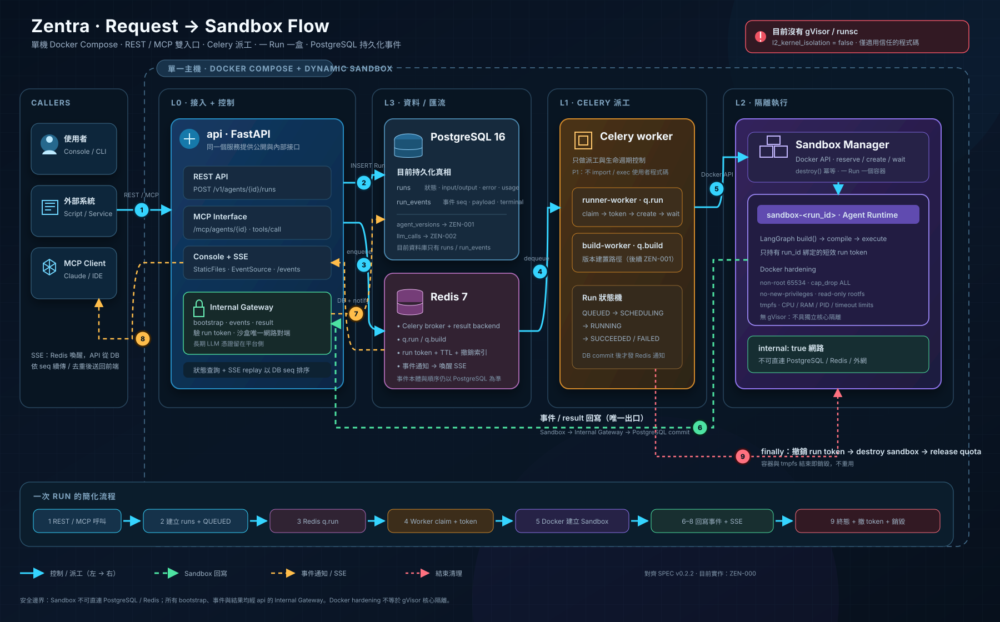](zentra-request-flow.svg)

這張圖由左到右呈現 REST／MCP 呼叫如何建立 Run、經 Redis 與 Celery 派工、透過 Docker API
動態建立一 Run 一盒的 Sandbox，以及事件／結果如何經 Internal Gateway 回寫 PostgreSQL 並串流到前端。
安全標示以目前實作為準：有 Docker hardening，**沒有 gVisor**，`l2_kernel_isolation=false`。

> 圖中的 `data/bundles · data/venvs` 是 v0.2 的舊 artifact 標示；v0.3 的權威資料流已改為
> 「既有 OCI Registry → VM Docker image cache」，PostgreSQL 只存 digest 與 metadata。

一台主機、一個 `docker compose`、**四個**長駐服務，加上**每個 Run 動態建立、結束即銷毀**的沙盒容器。
沙盒掛在一個沒有對外路由的網段上，唯一的對端是 `api` 服務的 Internal Gateway。
Console 沒有自己的容器 —— 它是 `api` 服務出去的一包靜態檔。

---

## 1. 系統全景（單機拓撲）

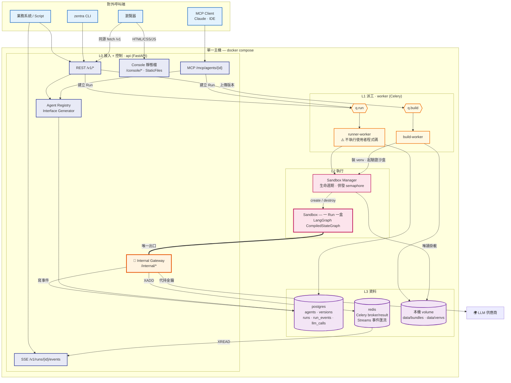

**三條硬規則**（SPEC §5）：
1. 沙盒**不得**直連 Postgres 或 Redis。
2. 沙盒的網路對端**有且只有一個**：`api`。
3. `worker` 全程不 `import` 使用者模組（P1）。

**Console 沒有 BFF**：瀏覽器先跟 `api` 拿 HTML/CSS/JS，再用同源 `fetch` 打 `/v1` ——
就是外部系統用的那份 API（[ADR-0006](../../specs/adr/ADR-0006-vanilla-frontend.md)）。

---

## 2. 發布一個版本（P1 + P5）

> v0.3 的權威發布圖見 [`oci-image-agent-flow.md`](oci-image-agent-flow.md)。下圖是 v0.2 bundle 設計的歷史圖，
> 已由 ADR-0008 取代，不得作為實作契約。

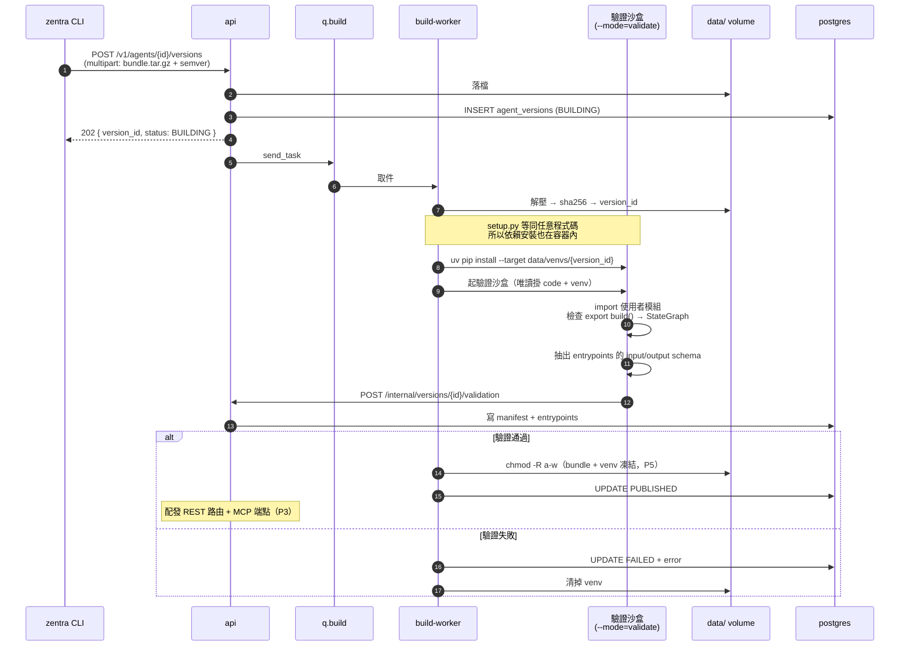

**P1 的細節**：連「檢查 `build()` 是否存在」都在沙盒裡做。
因為 `import` 使用者模組就是執行使用者程式碼——build-worker 的行程裡不能有這一步。

**P5 的實作**：`version_id` 是 bundle 的 SHA-256，發布後目錄設唯讀。
同一個 `semver` 重複上傳回 `409`。

---

## 3. 一次 Run 的完整時序（核心流程）

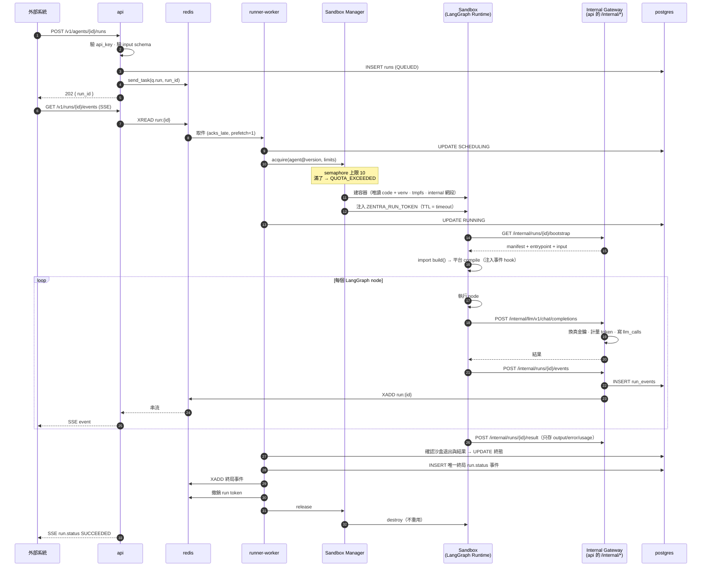

**安全重點（P1）**：`runner-worker` 全程只做「申請沙盒、回寫狀態」，
**從來沒有在自己的行程裡 import 或 exec 使用者的程式碼**。

**P4 的重點**：沙盒拿到的只有一個綁死 `run_id`、TTL = timeout 的 token，
而且它的網段根本沒有對外路由——即使 token 外洩，拿著它也只能對 Internal Gateway 說話。

---

## 4. 沙盒隔離模型（核心技術）

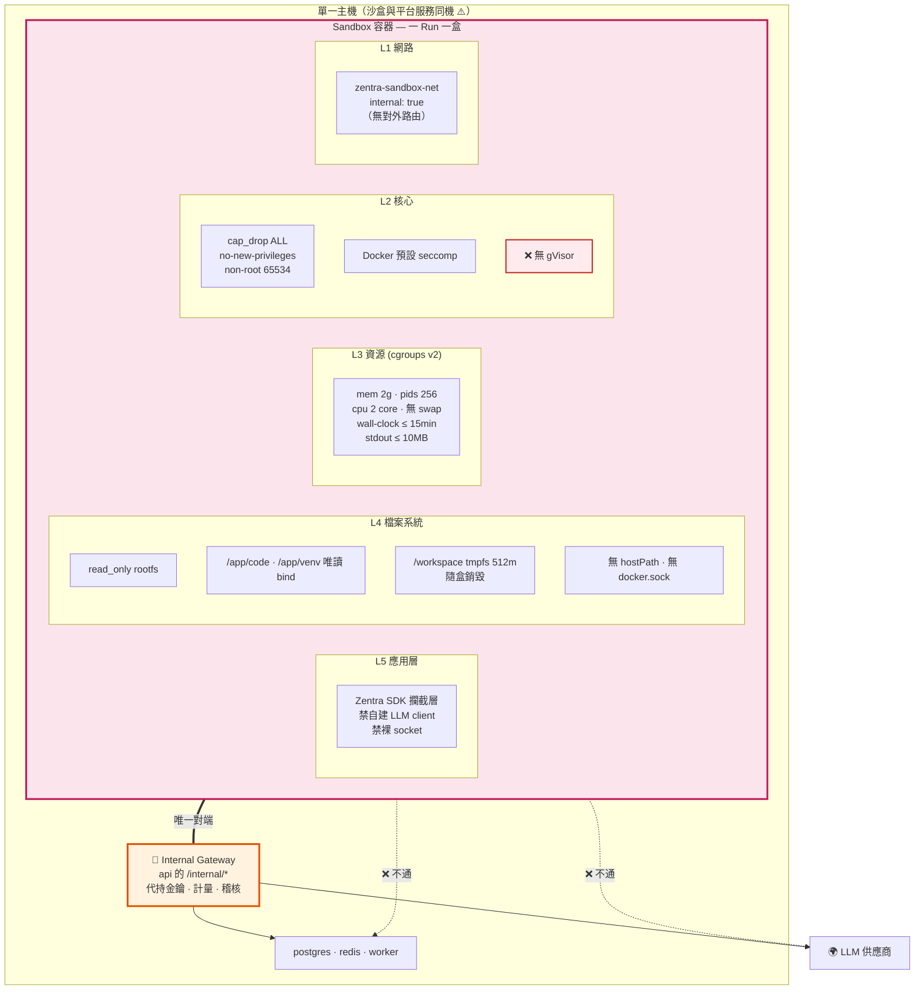

### 誠實標示：這個等級擋得住什麼、擋不住什麼

| 擋得住 | 擋不住 |
|---|---|
| 讀寫主機檔案系統 | **核心層的容器逃逸**（無 gVisor） |
| 直連資料庫、Redis、內網 | 沙盒與平台服務**同機**，逃逸後鄰居就是憑證 |
| 直接打外網、打雲端 metadata 端點 | |
| 偷長期憑證（沙盒裡根本沒有） | |
| 吃光 CPU / 記憶體 / process 影響鄰居 | |

**因此：這個架構適用於信任的程式碼，不適用於公開多租戶。**
`SandboxDriver.capabilities()` 必須回報 `l2_kernel_isolation: false`，
對應的安全測試標 `skipped` 而非 `passed`。要跑不可信程式碼 → 回頭讀 [ADR-0001](../../specs/adr/ADR-0001-sandbox-isolation.md)。

### 沙盒生命週期

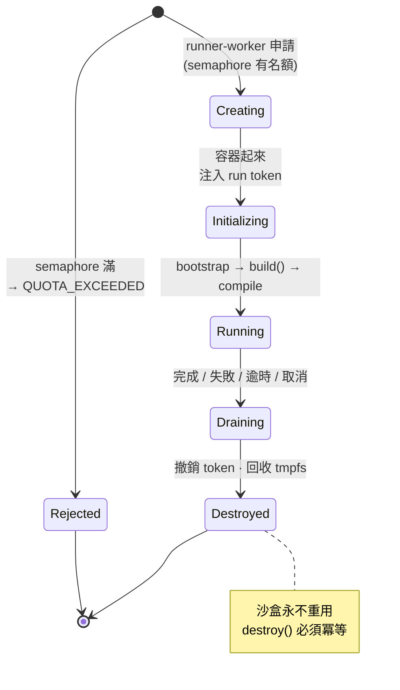

---

## 5. Celery 派工

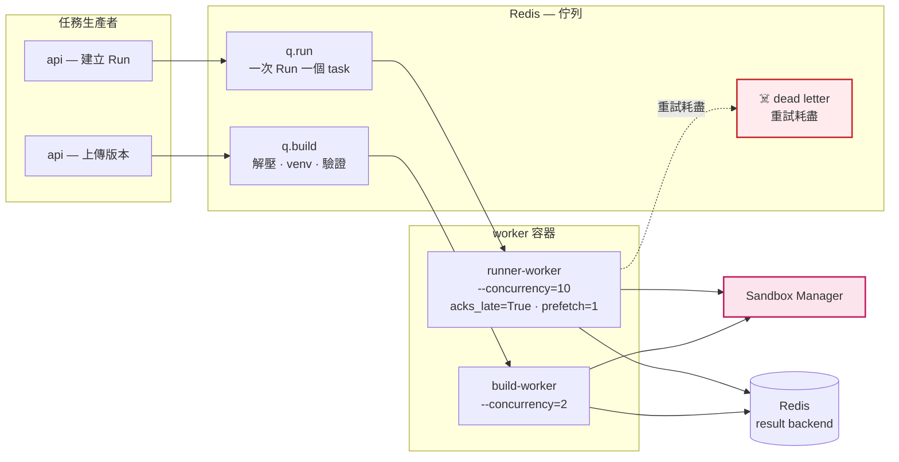

**從 v0.1 降維的部分**：broker 從 RabbitMQ 換成 Redis；六條佇列降成兩條
（砍 `q.agent.long` / `q.agent.priority` / `q.ingest` / `q.eval`）；
無 Beat、無 KEDA 自動擴縮——單機的 worker 併發用 `--concurrency` 寫死。

### Celery 與 LangGraph 的職責邊界（常見混淆點）

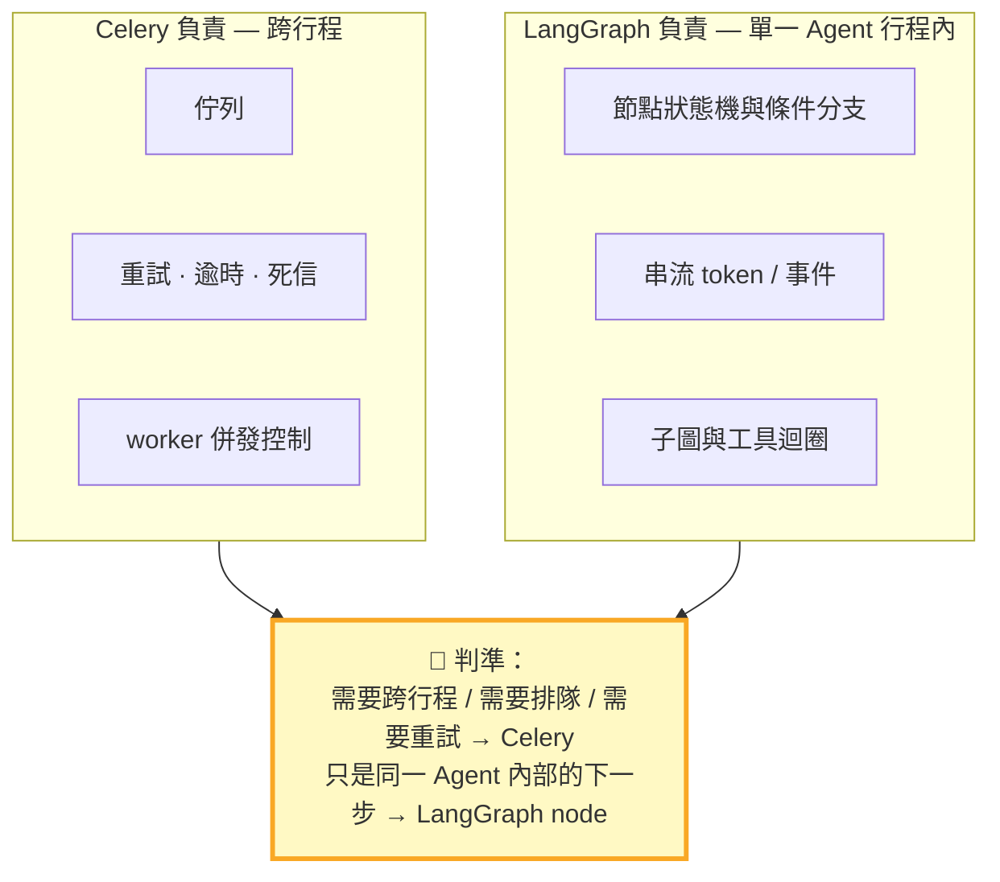

判準不變，見 [ADR-0002](../../specs/adr/ADR-0002-celery-langgraph-boundary.md)。
**一次 Run 就是一個 Celery task，不管圖裡有幾個節點。**

---

## 6. Agent Runtime 內部（沙盒中）

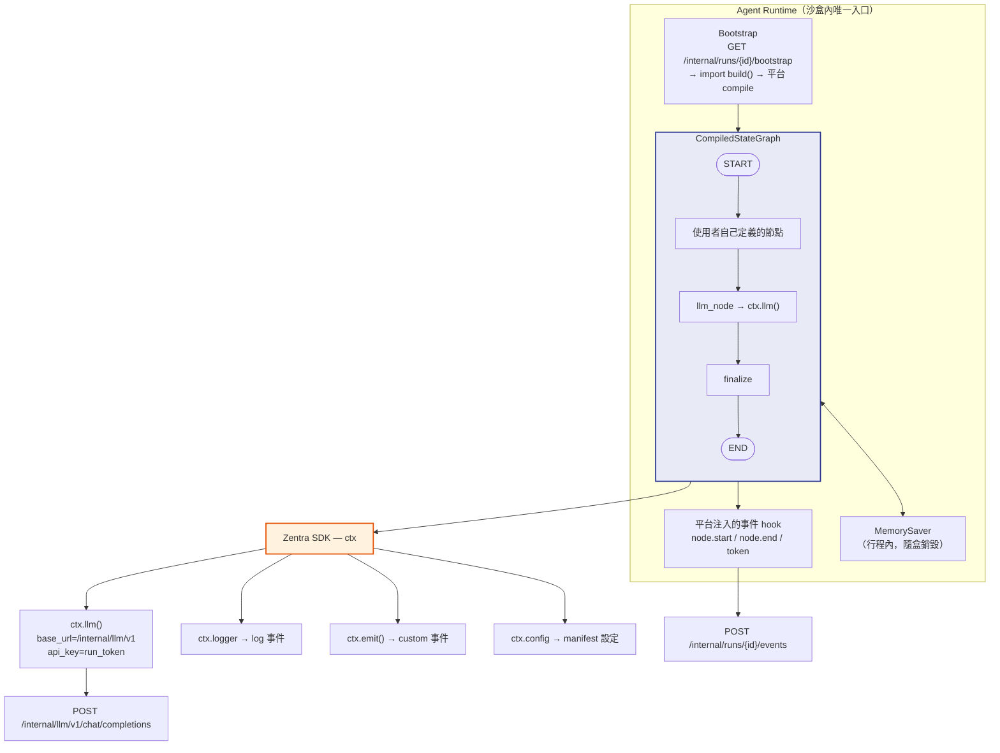

**`ctx.llm()` 的關鍵設計**：Internal Gateway 的 LLM 端點做成 **OpenAI 相容**，
所以 `ctx.llm()` 只是一個設了 `base_url` 與 `api_key=run_token` 的標準 LangChain chat model。
SDK 不需要自訂 client，使用者拿到的就是熟悉的 LangChain 介面——**而真金鑰從來沒進過沙盒**（P4）。

**MVP 的 `ctx` 沒有** `tools` / `knowledge` / `secrets`。使用者要工具就在自己的 graph 裡寫
（它們一樣跑在沙盒內、一樣沒有外網），平台級的 Tool Registry 在 MVP 外。

---

## 7. 每個 Agent 的雙門面（API + MCP）

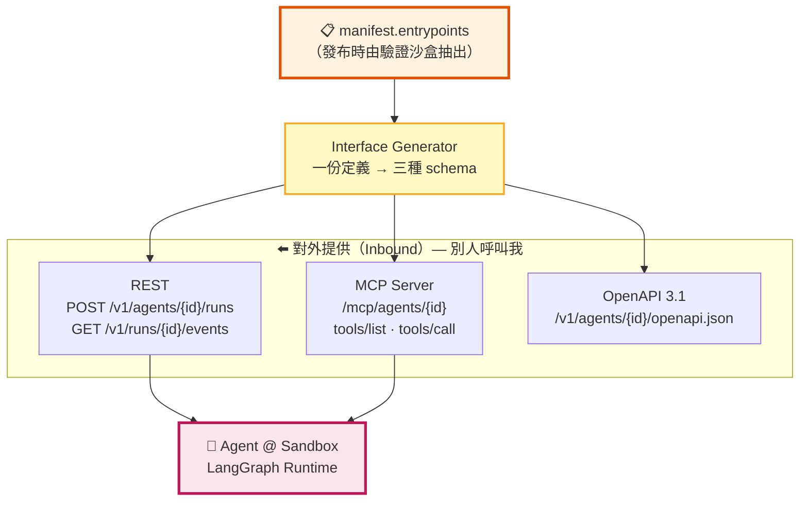

**P3 的實作要求**：`tools/list` 的 input schema 與 REST 的 `input` schema
**必須由同一份 entrypoint 定義生成**，契約測試要驗證兩者等價。

> v0.1 的「Outbound 門面」（Tool Registry / 外接 MCP Client / Agent-as-Tool）在 MVP 外。
> 使用者仍然可以在自己的 Agent 程式碼裡呼叫東西——但**要經過 Internal Gateway，否則網路不通**。

---

## 8. 資料模型（五張表）

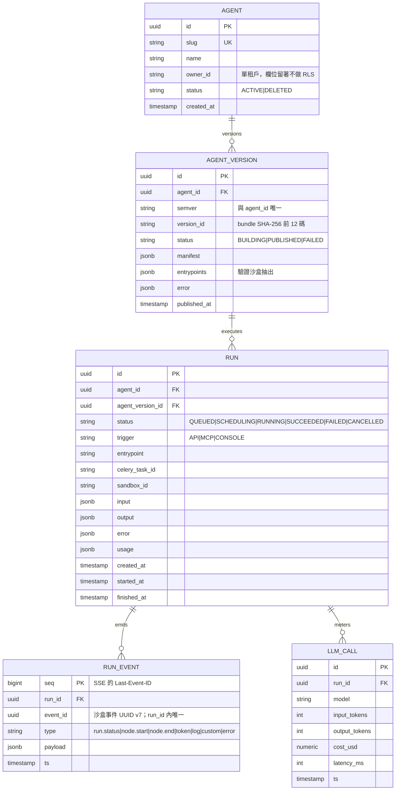

**為什麼 `run_events` 要落 Postgres 而不只是 Redis Streams**：
SSE 要支援 `Last-Event-ID` 續傳，而且 Run 結束後還要能回頭看事件流——這是 Console 最重要的功能。
Redis Stream 只是即時匯流管道，**持久化的真相在 Postgres**。
沙盒事件另有重送不變的 `event_id`，資料庫限制 `(run_id,event_id)` 唯一；
DB 成功但 Redis 發布失敗時用原 `seq` 重送，SSE 以 `seq` 去重排序（[ADR-0007](../../specs/adr/ADR-0007-run-completion-and-event-retry.md)）。

**沒有的表**（對照 v0.1）：`TENANT`、`USER`、`API_KEY`、`TOOL`、`SKILL`、`FLOW`、
`KNOWLEDGE_COLLECTION`、`DOCUMENT`、`CHUNK`、`EMBEDDING`、`RUN_CHECKPOINT`、`AGENT_ALIAS`、`SANDBOX_INSTANCE`。
它們都在 MVP 外——**不預先建空表**。

---

## 9. 部署拓撲（docker compose）

**四個長駐服務。** Console 沒有自己的容器 —— `api` 用 `StaticFiles` 掛載 `apps/console/`，
再以五條 `FileResponse` 路由給出乾淨網址：

| 網址 | 檔案 |
|---|---|
| `/console/agents` | `agents.html` |
| `/console/agents/{agent_id}` | `agent.html` |
| `/console/agents/{agent_id}/versions/new` | `version-new.html` |
| `/console/runs` | `runs.html` |
| `/console/runs/{run_id}` | `run.html` |

`/` 轉址到 `/console/agents`，靜態資產掛在 `/console/static/*`。
**沒有前端路由器** —— 深層連結、上一頁、404 全部由伺服器處理（[ADR-0006](../../specs/adr/ADR-0006-vanilla-frontend.md)）。

`/internal/*` 與公開 API 共用 `api:8000`；主機映射埠也能到達該路由。
MVP 以綁定 Run 的短效 token 控制存取，並未實作來源 IP 封鎖；
「Internal Gateway」指沙盒唯一可用的網路對端與非公開契約，不代表路由在公開 listener 上不可達。

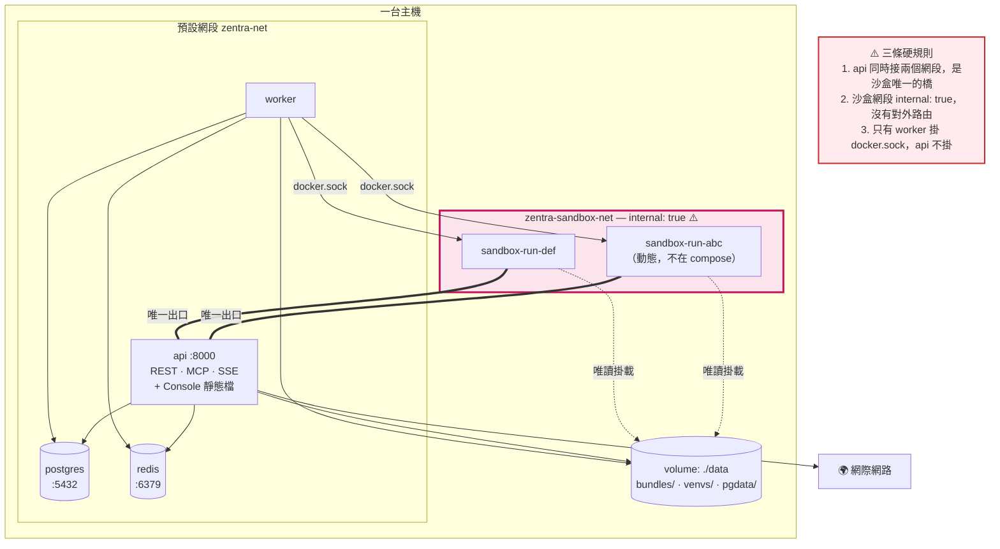

### `docker.sock` 的風險，明確記錄

`worker` 需要 `/var/run/docker.sock` 才能動態建沙盒，而**能操作 docker.sock 等同主機 root**。

v0.1 的 ADR-0004 把這條列為「僅限本機開發，正式環境絕對禁止」。
**v0.2.0 的正式環境就是這一套，所以這個風險現在是常駐的。** 誠實記錄，不要假裝它不存在：

| | |
|---|---|
| 現在為什麼可接受 | 內部工具、單租戶、只跑信任的程式碼。能碰到 `worker` 的人本來就有主機權限 |
| 什麼時候不可接受 | 一旦要跑不是自己寫的程式碼，或出現第二個租戶 |
| 到時候怎麼辦 | `docker-socket-proxy` 限縮成只能建刪容器、rootless dockerd，或直接上 k3s（ADR-0005 的首選替代方案） |

---

## 10. 降維對照表（v0.1 → v0.2）

| v0.1 元素 | v0.2 怎麼了 | 理由 |
|---|---|---|
| Kubernetes + Helm + 專用 node pool | → **單機 docker compose** | ADR-0005：內部工具、單租戶、信任程式碼 |
| gVisor (runsc) RuntimeClass | → **移除**，L2 只剩 Docker 原生機制 | 同上。`capabilities()` 誠實回報 |
| RabbitMQ | → **Redis** 同時當 broker + result + Streams | 少一個服務 |
| OpenSearch + pgvector Hybrid Search | → **移除**（知識層整層移出 MVP） | 範圍收斂 |
| MinIO / S3 | → **本機 volume** + `ObjectStore` 介面 | 少一個服務，介面留著 |
| ClickHouse | → Postgres 的 `llm_calls` 表 | 少一個服務 |
| Vault | → compose env / Docker secret | 沙盒本來就拿不到，不需要 Vault |
| Tool Proxy + LLM Proxy + Egress Proxy | → **Internal Gateway**（api 上的 `/internal/*`） | 三個容器併成一組路由，P4 不變 |
| Warm Pool | → **移除** | 共用 runtime image 冷啟已 < 2s |
| per-agent image build + CVE/License 掃描 | → 共用 runtime image + per-version venv 目錄 | 信任程式碼不需要供應鏈掃描 |
| OpenTelemetry + Langfuse + Prometheus | → 結構化 JSON log + `run_events` + `llm_calls` | 單機不需要分散式追蹤 |
| 六條佇列 + Beat + KEDA | → `q.run` + `q.build` | 單機 |
| 平台組裝式 Agent（路徑 A） | → **移出 MVP** | 第二條建立路徑，八週做不完 |
| Agent Flow（React Flow 畫布） | → 原本就是 MVP 外 | |
| HITL / `WAITING_INPUT` / Checkpointer | → **移出 MVP**，狀態機已移除該值 | |
| 多租戶 + RLS | → 單租戶，留 `owner_id` 欄位不做 RLS | |
| L0–L6 七層 | → **四層** L0 接入+控制 / L1 派工 / L2 執行 / L3 資料 | |
| 14 張架構圖 | → **11 張** | 砍掉的東西不需要圖 |
| Next.js + React + TypeScript + Tailwind + shadcn/ui | → **原生 HTML + CSS + ES modules，零建置** | [ADR-0006](../../specs/adr/ADR-0006-vanilla-frontend.md)：五個畫面撐不起這套工具鏈 |
| `console` 容器（第 5 個服務） | → **移除**，由 `api` 的 `StaticFiles` 服務 | 長駐服務 5 → 4 |
| Console BFF（L0 的一個元件） | → **移除**，Console 同源直接打 `/v1` | 不需要 CORS，且 Console 成為 API 契約的第一個消費者 |
| TanStack Query + Zustand | → 一個 ~40 行的 `store.js` | 只有 Run 觀測頁需要共享狀態 |
| Vitest + pnpm + node_modules | → **移除**；Playwright 保留 | 沒有建置步驟就沒有前端建置工具 |

**沒有變的**：五條核心立場 P1–P5、`SandboxDriver` 抽象與 `capabilities()` 誠實原則、
Celery ↔ LangGraph 的判準（ADR-0002）、entrypoints 單一定義生成雙門面（ADR-0003）。
