# Zentra Agent Platform — 詳細架構圖

> 本文件是 `Simplified_architecture_diagram.png` 的展開版。
> 規格定義以 [`specs/SPEC.md`](../../specs/SPEC.md) 為準，本文件只負責「畫清楚」。

## 0. 總覽（基礎設施視角）

下圖把本文件的細節收斂成單張實作層級架構圖：接入層、控制平面、Celery 佇列拓撲與 worker 池、
沙盒五層隔離與 Agent Runtime 內部、受控出口，以及知識層、資料層與觀測層。
本文件其餘章節是各區塊的逐項展開。

---

## 1. 系統全景圖（Layered Architecture）

對應簡義圖的三大塊：**對外接口** → **Agent Platform** → **文件知識層**。
為了看得清楚，全景拆成「主幹」（本節）與「橫切面」（§1.1 資料與觀測）兩張。

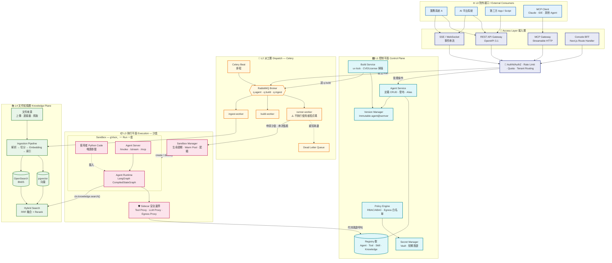

### 1.1 橫切面：資料層與觀測層

L5 / L6 被**所有層**使用，畫在主幹圖裡會讓線爆炸，因此獨立一張。

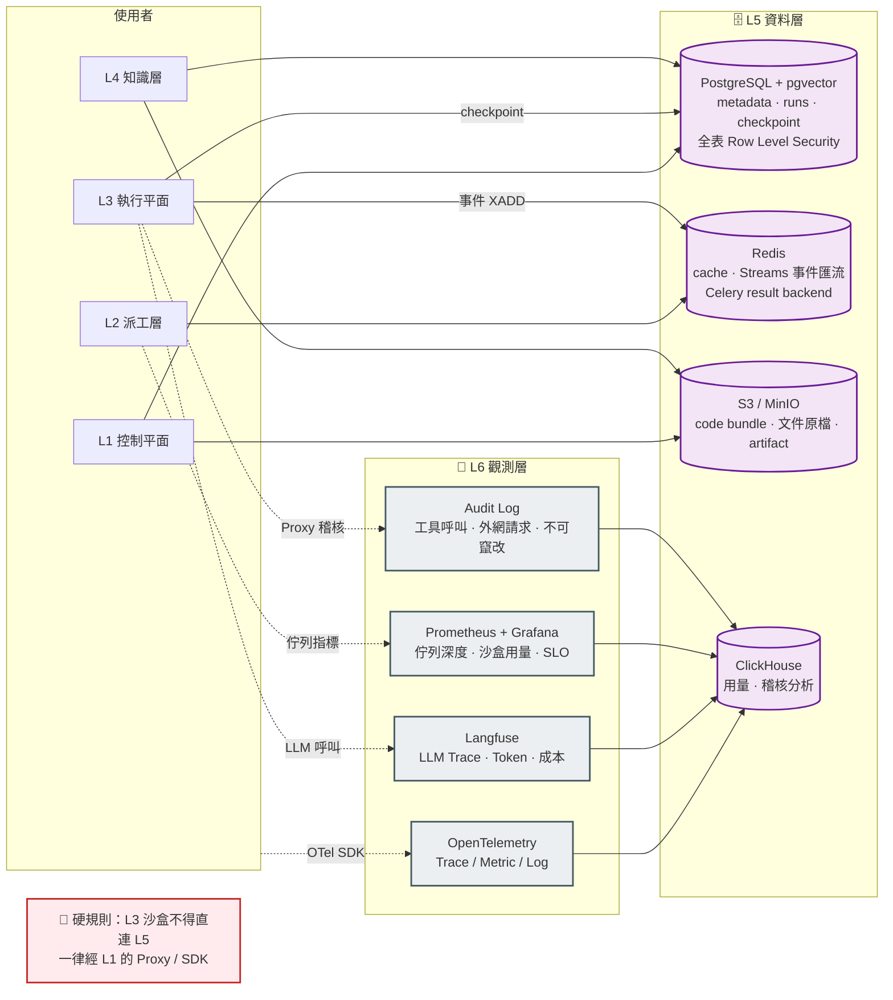

---

## 2. 兩種建立 Agent 的路徑

簡義圖上半部「平台建立 Agent」與「上傳 Agent Code」的展開。

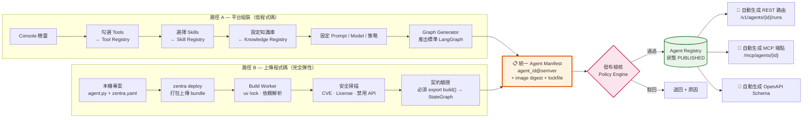

**關鍵**：兩條路徑最終收斂到**同一個 Manifest 格式**，下游（派工、沙盒、觀測）完全不需要知道 Agent 是怎麼來的。

---

## 3. 一次 Run 的完整時序（核心流程）

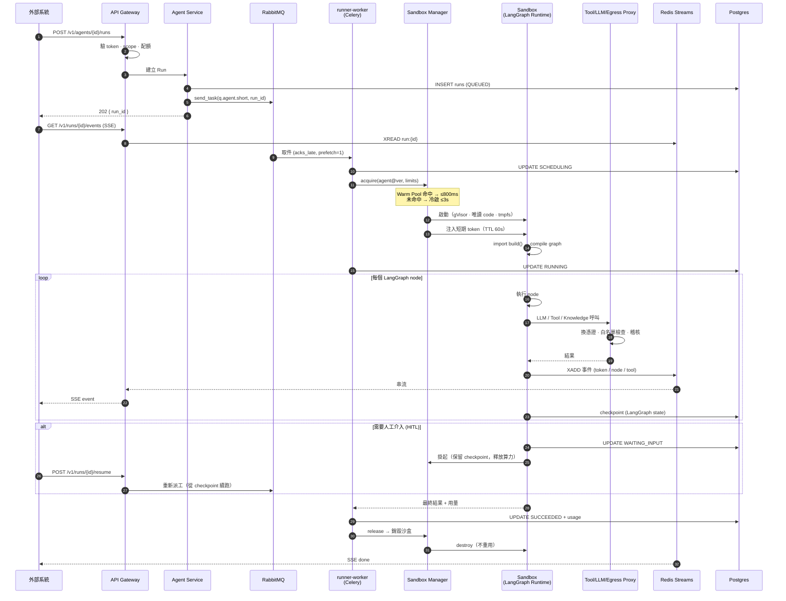

**安全重點（§P1）**：`runner-worker` 全程只做「申請沙盒、轉送事件、回寫狀態」，
**從來沒有在自己的行程裡 import 或 exec 使用者的程式碼**。

---

## 4. 沙盒隔離模型（核心技術 1）

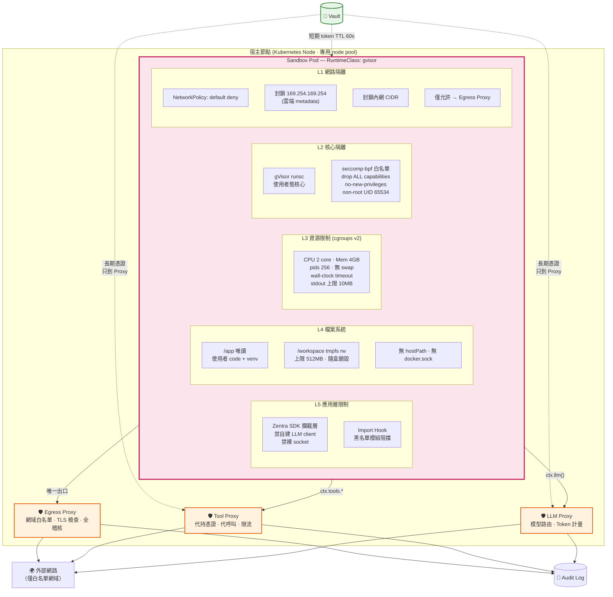

### 沙盒生命週期

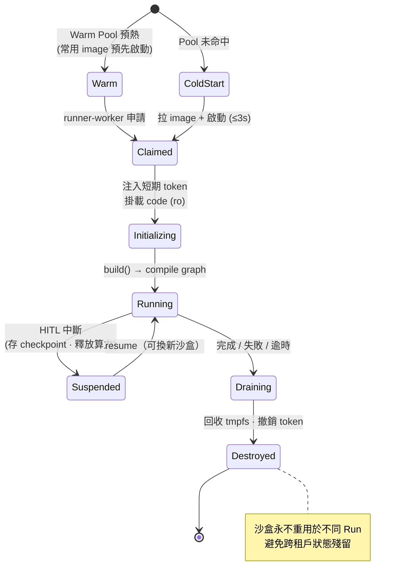

---

## 5. Celery 派工拓撲（核心技術 2）

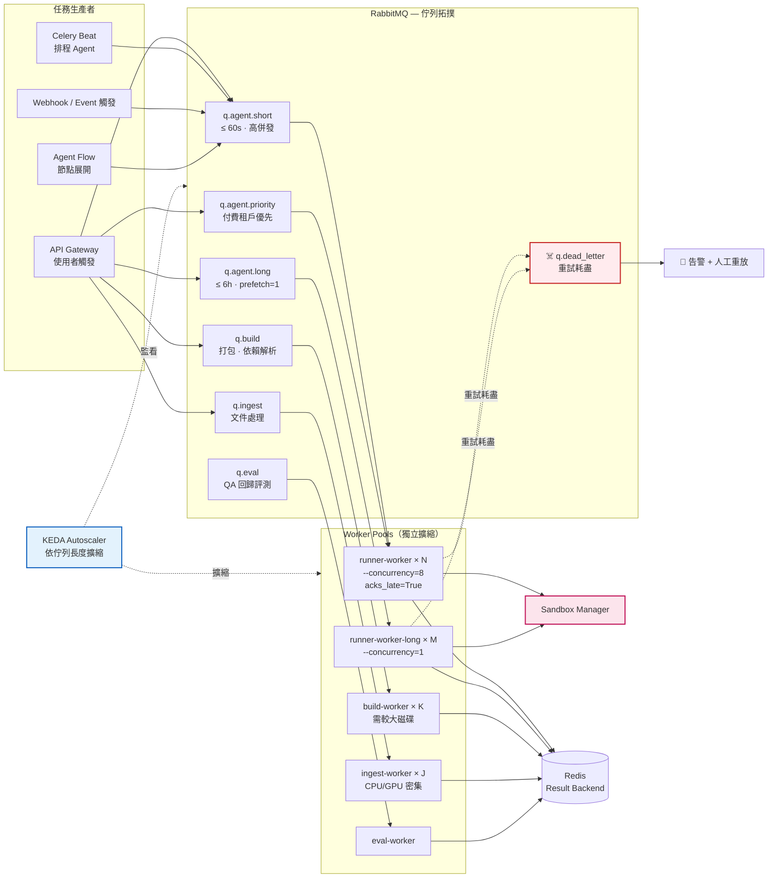

### Celery 與 LangGraph 的職責邊界（常見混淆點）

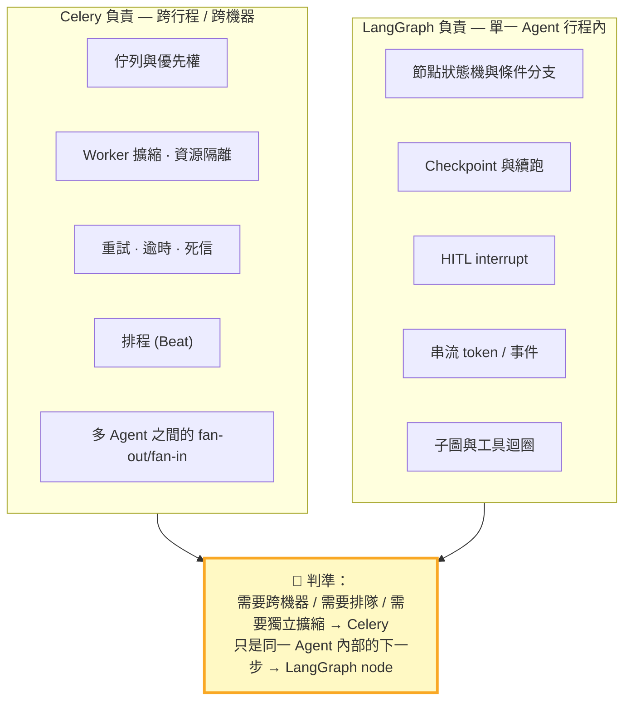

---

## 6. Agent Runtime 內部（LangChain + LangGraph）

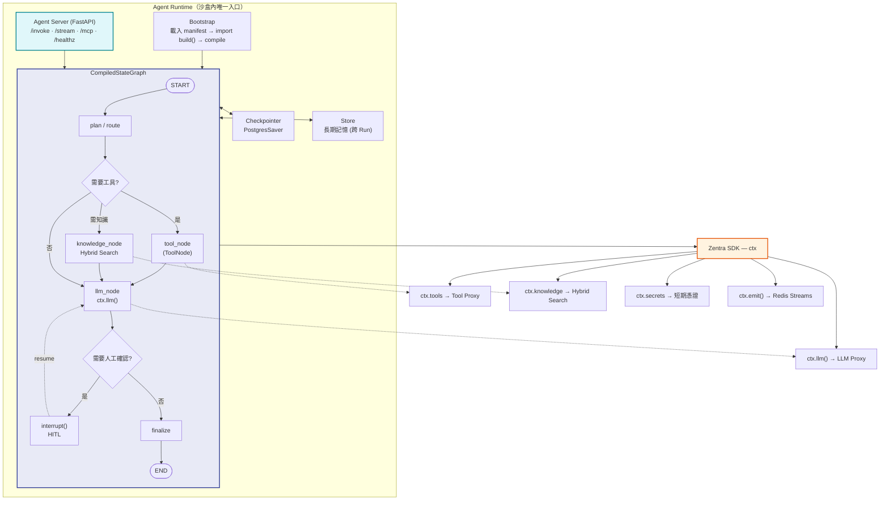

---

## 7. 每個 Agent 的雙門面（API + MCP）

簡義圖中每個 Agent 卡片的「外接API / 外接MCP」——**雙向**都要通。

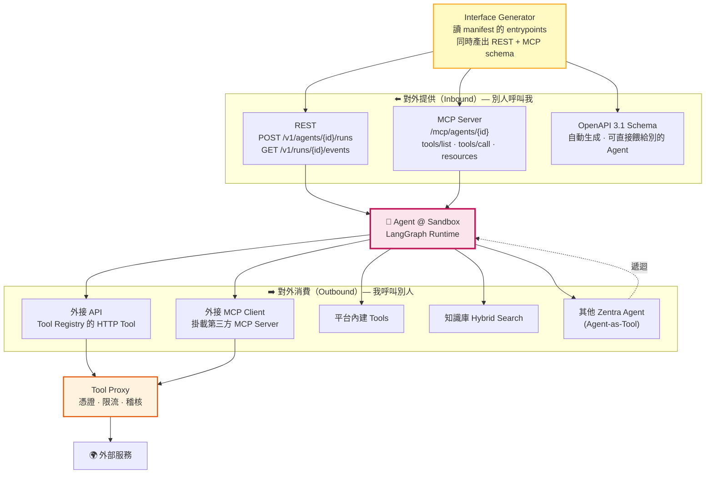

**設計重點**：`entrypoints` 在 manifest 宣告一次，REST schema 與 MCP tool schema 由同一份定義生成，
**永遠不會有 API 跟 MCP 行為不一致的問題**。

---

## 8. 文件知識層（Ingestion → Hybrid Search）

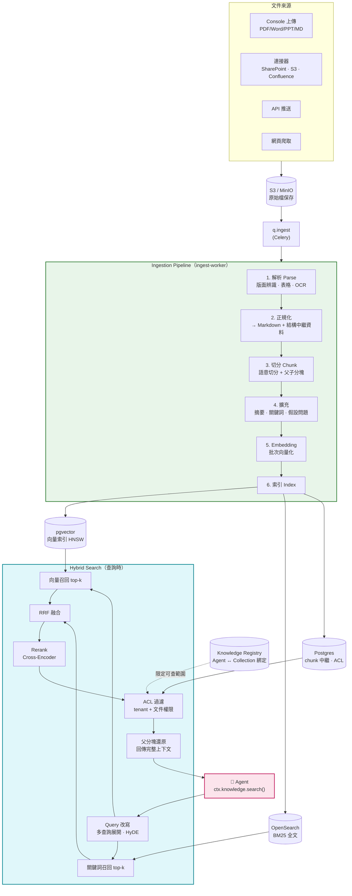

---

## 9. Agent Flow — 多 Agent 編排（選配）

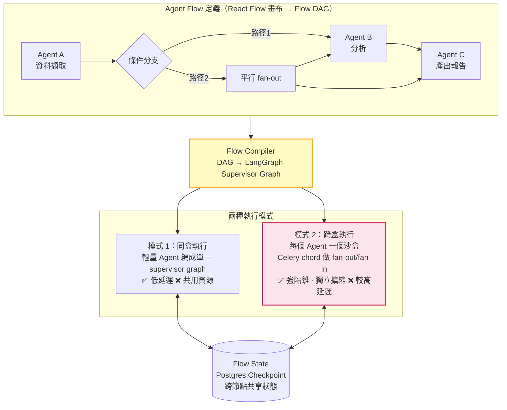

**選擇準則**：Agent 來自不同租戶 / 含上傳程式碼 / 需獨立擴縮 → **模式 2**（預設）。純平台組裝且信任邊界相同 → 模式 1。

---

## 10. 資料模型（ER 核心）

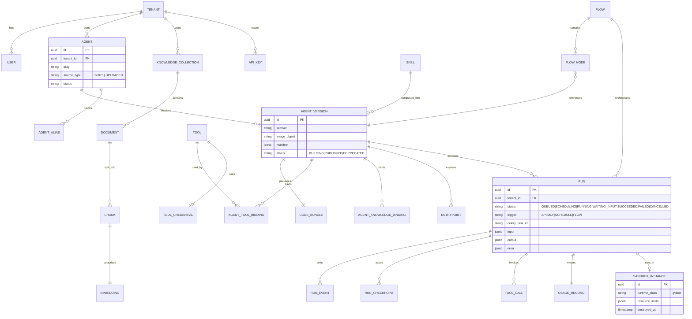

> 所有含 `tenant_id` 的表一律啟用 PostgreSQL Row Level Security，應用層過濾只是第一道防線。

---

## 11. 部署拓撲（Kubernetes）

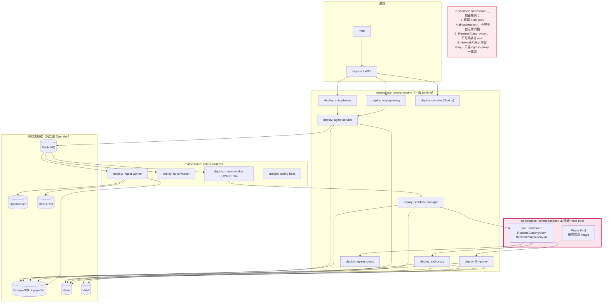

---

## 12. 與簡義圖的對照表

| 簡義圖元素 | 詳細架構對應 | 章節 |
|---|---|---|
| 對外接口 / MCP 接口 / REST API 接口 | Access Layer：MCP Gateway + REST Gateway + Auth + Rate Limit | §1, §7 |
| 平台建立 Agent（勾選 Tools / Skills / 知識庫） | 路徑 A：Console 精靈 → Graph Generator | §2 |
| 上傳 Agent Code（Python Package / 第三方套件） | 路徑 B：CLI → Build Worker → 掃描 → 契約驗證 | §2 |
| Agent A/B/C 的 Runtime | Sandbox 內的 LangGraph CompiledStateGraph | §6 |
| Agent 卡片的 外接API / 外接MCP | 雙門面模型（Inbound + Outbound） | §7 |
| Agent Flow（選配） | Flow Compiler → supervisor graph / Celery chord | §9 |
| Tool Registry / Skill Registry | 控制平面 Registry 群 + Tool Proxy | §1 |
| 平台基礎能力 · 隔離執行 | 沙盒五層隔離模型 | §4 |
| 平台基礎能力 · 權限與 Secret | Policy Engine + Vault + 短期憑證 | §1, §4 |
| 平台基礎能力 · Log·Trace | 觀測層 OTel + Langfuse + Audit Log | §1 |
| 平台基礎能力 · 版本管理 | Version Manager（immutable agent@semver + alias） | §1, §2 |
| 文件知識層（解析·切分·Embedding·索引） | Ingestion Pipeline 六階段 | §8 |
| Hybrid Search（Vector + Keyword） | RRF 融合 + Rerank + ACL 過濾 | §8 |
| （簡義圖未畫，但必須有） | Celery 派工層、Sandbox Manager、三個 Proxy、資料層、觀測層 | §1, §5 |
