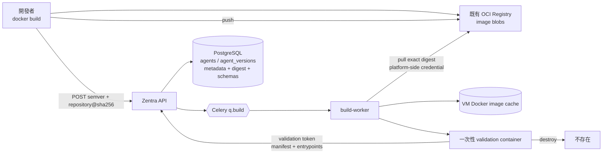
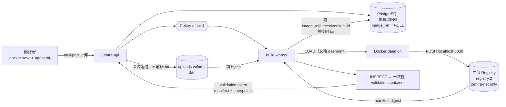
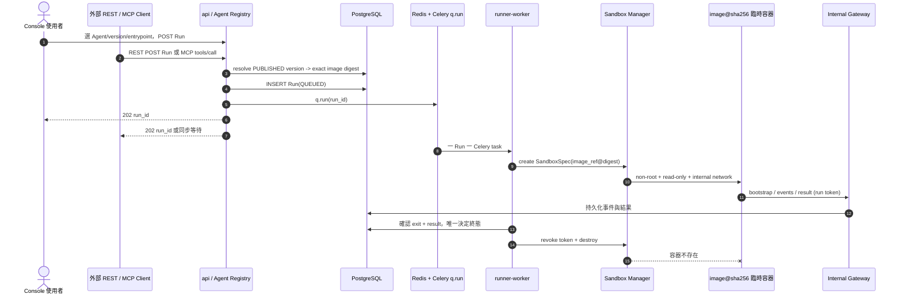
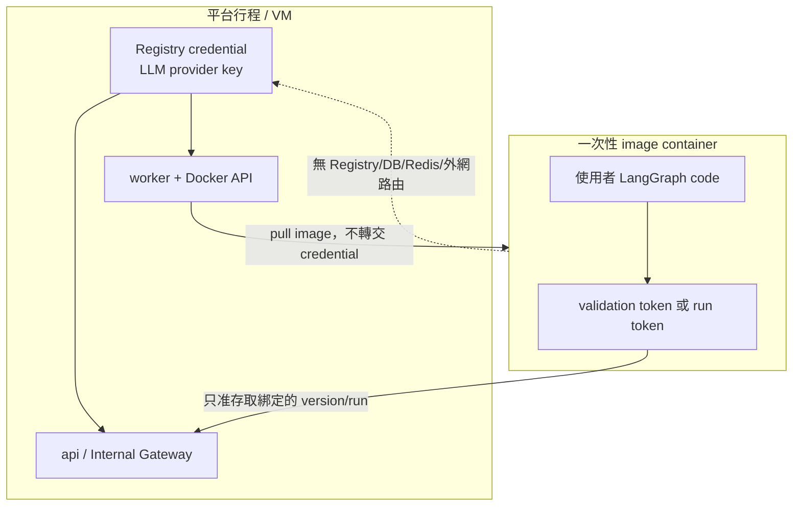

# OCI image 型 Agent：註冊到執行

> 權威定義：[`SPEC.md v0.4.0`](../../specs/SPEC.md)、
> [`ADR-0008`](../../specs/adr/ADR-0008-oci-image-agent-packaging.md)、
> [`ADR-0009`](../../specs/adr/ADR-0009-internal-registry-image-upload.md)、
> [`ZEN-008`](../../specs/features/ZEN-008/spec.md)、[`ZEN-009`](../../specs/features/ZEN-009/spec.md)。
> 本文件只畫清資料流。

## Image 在哪裡，PostgreSQL 存什麼

PostgreSQL 不存 image blob，也不存 Registry credential。`image_ref` 必須是 canonical digest reference；
tag 只可出現在開發者自己的 build/push 操作，不進發布身份。

## 上傳路徑（SPEC v0.4.0 / ADR-0009）

第二條進場路徑。它與上面的註冊路徑**在同一個點匯流**：`agent_versions.image_ref`
拿到 canonical `repository@sha256:<manifest digest>`。匯流之後只有一條程式碼路徑。

三件事一定要看懂：

1. **tar 從不進 PostgreSQL**，也不長期留在磁碟上——digest commit 後立刻刪除。
2. **平台行程不解析 tar**。`docker load` 是 daemon 的事；要 image 資訊就 load 完 `inspect`。
3. **push 成功前沒有版本身份**。`docker save`/`load` 會丟掉 registry manifest digest
   （`RepoDigests` 變空），所以 `version_id` 只能在 push 之後產生。
   DB CHECK 保證 `PUBLISHED` 必有完整 digest——沒有可重新 pull 的來源就不是已發布版本（P5）。

內部 Registry 只掛 `zentra-net`，**不掛 `zentra-sandbox-net`**。
`localhost:5000` 是給**主機上的 Docker daemon** 用的名字（daemon 不在 compose 網段上），
沙盒既看不到也連不到它。

## Console、REST、MCP 共用同一條 Run 路徑

image 內不提供 REST 或 MCP server，也不暴露 port。兩個門面都在 Zentra `api`；image 裡唯一的執行入口是
`/opt/zentra/bin/zentra-agent run`，它只能透過 Internal Gateway 取 input、送事件與結果。

## 信任與憑證邊界

目前仍是「內部工具、只跑自己信任的 image」。digest 只保證內容不可變，不等於內容安全；
沒有 gVisor、image 簽章或 CVE 掃描，不能宣稱可安全執行第三方不可信 image。
