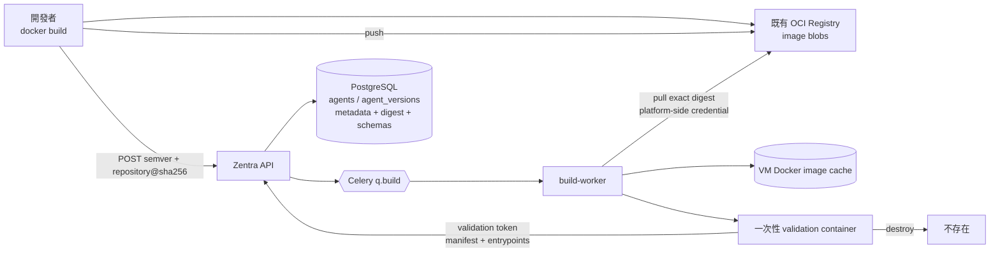
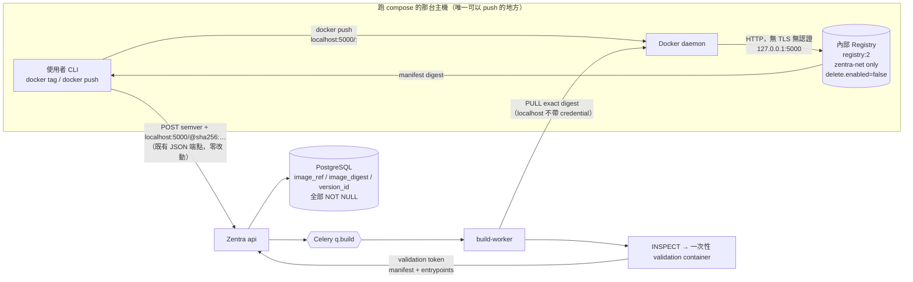
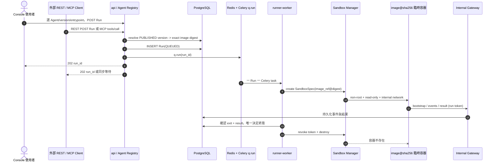
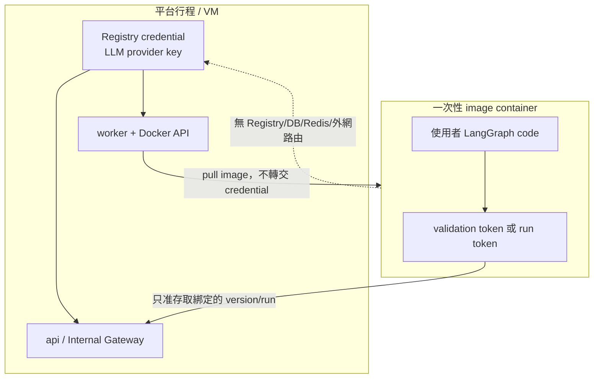

# OCI image 型 Agent：註冊到執行

> 權威定義：[`SPEC.md v0.4.1`](../../specs/SPEC.md)、
> [`ADR-0008`](../../specs/adr/ADR-0008-oci-image-agent-packaging.md)、
> [`ADR-0009`](../../specs/adr/ADR-0009-internal-registry-image-upload.md)、
> [`ZEN-008`](../../specs/features/ZEN-008/spec.md)、[`ZEN-009`](../../specs/features/ZEN-009/spec.md)。
> 本文件只畫清資料流。

## Image 在哪裡，PostgreSQL 存什麼

PostgreSQL 不存 image blob，也不存 Registry credential。`image_ref` 必須是 canonical digest reference；
tag 只可出現在開發者自己的 build/push 操作，不進發布身份。

## 內部 Registry：使用者在平台主機上 `docker push`（SPEC v0.4.1 / ADR-0009 R2）

> ⚠️ **本節在 v0.4.1 被改寫。** v0.4.0 畫的是「Console 上傳 `docker save` tar → worker
> `LOAD` → `PUSH`」。**那條路徑已撤回**（[ADR-0009 修訂 R2](../../specs/adr/ADR-0009-internal-registry-image-upload.md)）：
> 平台**不接收 image 檔案**，`api` 與 `worker` 完全不在 push 路徑上。

**版本進場只有一條路徑**（上面那張圖）。內部 Registry 只是 image 可以待的第二個地方，
它改變的是**使用者怎麼把 image 放進 Registry**，不是平台怎麼註冊版本。

四件事一定要看懂：

1. **平台不在 push 路徑上。** `docker push` 發生在使用者 CLI 與主機 daemon 之間，
   `api` 與 `worker` 看不到它。因此容量、清理、備份是**維運者的責任**，平台不做預檢也沒有訊號。
2. **loopback 綁定就是存取控制。** `127.0.0.1:5000` 表示只有該主機上的行程連得到 ——
   「只限同機 push」不是文件規定，是網路事實。**綁 `0.0.0.0` 需新 ADR，且必須先解決 TLS 與認證。**
3. **沒有任何平台服務會連 registry。** client 只有主機 daemon 與使用者 CLI。
   `api` / `worker` 不需要 `depends_on: registry`。
4. **平台不得代理 Registry HTTP 端點。** `api` 同時掛在 `zentra-net` 與 `zentra-sandbox-net` 上，
   任何「幫你查 registry」的端點都會變成沙盒觸達 Registry 的跳板，直接打穿 P4。
   `/v2/_catalog` 不遮蔽（能連 loopback 的人本來就有主機 root），但**平台一條路都不提供**。

內部 Registry 只掛 `zentra-net`，**不掛 `zentra-sandbox-net`**，沙盒既看不到也連不到它。

## Console、REST、MCP 共用同一條 Run 路徑

image 內不提供 REST 或 MCP server，也不暴露 port。兩個門面都在 Zentra `api`；image 裡唯一的執行入口是
`/opt/zentra/bin/zentra-agent run`，它只能透過 Internal Gateway 取 input、送事件與結果。

## 信任與憑證邊界

目前仍是「內部工具、只跑自己信任的 image」。digest 只保證內容不可變，不等於內容安全；
沒有 gVisor、image 簽章或 CVE 掃描，不能宣稱可安全執行第三方不可信 image。
