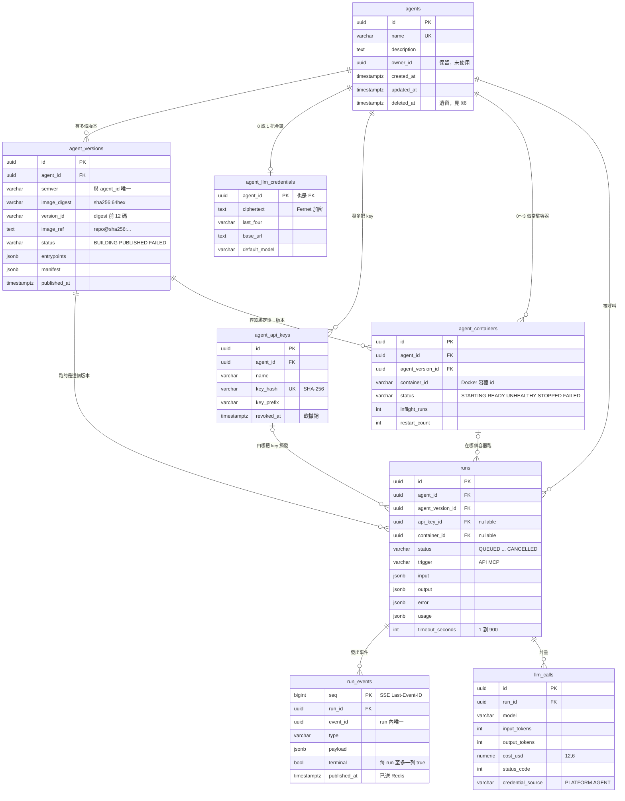

# PostgreSQL 資料儲存規格

| | |
|---|---|
| 對齊 schema | migration **`0008`**（Alembic revision `0008_agent_config_secrets_egress`；ZEN-020 後為 `apps/api/migrations/0008_agent_config_secrets_egress.sql`）。⚠️ **§2 尚未補上 `0008` 的五張表**，見 §6 第 6 點 |
| 對齊 Spec | `specs/SPEC.md v0.6.0`、`specs/api-contract.md v0.12.1` |
| 服務 | compose 的 `postgres`（image `pgvector/pgvector:pg16`，pgvector 擴充備而不用），只掛 `zentra-net`，volume `pgdata` |
| 最後核對 | 2026-10-01，以 `\d+` 對照執行中的資料庫逐欄核對 |

這份文件描述**資料怎麼存**：每張表、每個欄位、約束、索引、外鍵的刪除行為，以及它們為什麼長這樣。
**行為**（狀態怎麼轉、API 回什麼）仍以 `SPEC.md` 與 `api-contract.md` 為準，這裡只引用不重述。

> **schema 的唯一事實來源是 migration 的 `.sql` 檔**（[ADR-0015](../adr/ADR-0015-plain-sql-no-orm.md) §7），
> 不是這份文件，也不是任何 Python 檔。
>
> **改 schema 的順序**：新增一支 `apps/api/migrations/NNNN_<name>.sql` → `make migrate` 跑起來 →
> 同步 `apps/api/rows.py` 的欄位（有測試比對）→ 回來更新這份文件與 §7 的變更紀錄。
> 已套用的 `.sql` 不得修改（runner 會比對 checksum 拒絕）。這份文件落後於 migration 就是 bug。
>
> schema 跟 `.sql`；列的形狀跟 `apps/api/rows.py`。

---

## 1. 總覽

### 1.1 PostgreSQL 在平台裡負責什麼

**所有需要「事後查得到」的東西。** 平台的另一個儲存 Redis 只放會過期的東西
（佇列、token、即時通知），Redis 整個清空時平台會掉進行中的工作，但**不會掉任何紀錄**。
這條分界見 [`Redis.md`](./Redis.md) §1。

| 誰在寫 | 寫什麼 |
|---|---|
| `app`（FastAPI） | Agent、版本註冊、Run 建立、Gateway 收到的事件與 LLM 呼叫、憑證、API key |
| `worker`（Celery） | 版本發布結果、Run 狀態轉移、常駐容器生命週期 |
| 沙盒 | **不能直接連。** 沙盒網段沒有到 `postgres` 的路由（P4），它的資料都經 `app` 的 `/internal/*` 寫入 |

### 1.2 八張表

| 表 | 一列代表 | 規模的量級 | 引入 |
|---|---|---|---|
| [`agents`](#21-agents) | 一個 Agent | 數十 | ZEN-008 |
| [`agent_versions`](#22-agent_versions) | Agent 的一個不可變版本（= 一個 image digest） | 每 Agent 數個～數十 | ZEN-008 |
| [`runs`](#23-runs) | 一次呼叫 | **會一直長** | ZEN-000 |
| [`run_events`](#24-run_events) | Run 的一個事件（SSE 的一則） | **最大**，每 Run 數十～數百 | ZEN-000 |
| [`llm_calls`](#25-llm_calls) | 經 Gateway 的一次 LLM 呼叫 | 每 Run 0～數十 | ZEN-002 |
| [`agent_llm_credentials`](#26-agent_llm_credentials) | 一個 Agent 的 LLM 金鑰（加密） | 每 Agent 0～1 | ZEN-012 |
| [`agent_api_keys`](#27-agent_api_keys) | 發給下游應用的一把 key（雜湊） | 每 Agent 數把 | ZEN-015 |
| [`agent_containers`](#28-agent_containers) | 一個常駐容器 | 每 Agent 0～3 | ZEN-015 |

另有兩張版本表（ADR-0015 §7）：

| 表 | 說明 |
|---|---|
| `schema_migrations` | migration runner 的版本表，每支已套用的 `.sql` 一列：`version`（PK，如 `0008`）、`name`、`checksum`（檔案原始位元組的 SHA-256，小寫 hex）、`applied_at`。ZEN-020 起才有 |
| `alembic_version` | Alembic 的遺留表，一列 `version_num='0008'`。**runner 不認得它**；既有資料庫由一次性腳本 `scripts/adopt-legacy-schema.sh` 讀一次，據此建出 `schema_migrations`，之後沒有人再碰。**凍結保留**作為退回舊 image 的退路；**`0009` 的第一條語句刪掉它**，腳本也在同一個 PR 刪除 |

ZEN-019（`0008`）新增的五張表 `agent_settings`、`agent_secrets`、`agent_egress_rules`、`agent_email_sender`、`egress_calls`
尚未寫進本文件 §2，見 §6 第 6 點。

### 1.3 ER 圖



### 1.4 全表共通慣例

| 慣例 | 說明 |
|---|---|
| **主鍵是 UUID v7** | 由應用程式產生（`apps/api/ids.py` 的 `uuid7()`），資料庫**沒有** default。v7 依時間排序，所以 `ORDER BY id` 近似建立順序，cursor 分頁也靠它。唯一例外：`run_events.seq` 是 `bigserial`（理由見 §2.4）、`agent_llm_credentials` 以 `agent_id` 為主鍵 |
| **時間一律 `timestamptz`** | 存 UTC，API 輸出 RFC 3339。`created_at` 有 `DEFAULT now()`，其餘時間欄位由應用程式寫 |
| **狀態欄是 `varchar` + `CHECK`，不是 PG enum** | 值域照抄 `SPEC.md` §9 與 `apps/api/enums.py`。加值要改 CHECK（一支 migration），PG enum 改值則麻煩得多 |
| **彈性結構用 `jsonb`** | `input` / `output` / `error` / `entrypoints` 等的形狀由契約定義，不拆欄位 |
| **金額用 `numeric(12,6)`** | 不用 float。API 輸出時轉成十進位字串（契約 §1 的 `cost_usd`） |
| **外鍵的刪除行為是刻意選的** | 不是全部 CASCADE。見 §3 |

---

## 2. 各表詳細

欄位表的「必填」指 `NOT NULL`。「寫入者」標出哪個服務會改這一欄，方便追「這個值是誰寫壞的」。

### 2.1 `agents`

一個 Agent 的 metadata。**不放任何跟版本有關的東西** —— 那些在 `agent_versions`。

| 欄位 | 型別 | 必填 | 預設 | 說明 |
|---|---|---|---|---|
| `id` | `uuid` | ✅ | — | PK，UUID v7 |
| `name` | `varchar(255)` | ✅ | — | **全表唯一**。Console 與 API 用來辨識 Agent |
| `description` | `text` | | — | 選填 |
| `owner_id` | `uuid` | | — | **保留未使用**。單租戶（ADR-0005），欄位留著不做 RLS |
| `created_at` | `timestamptz` | ✅ | `now()` | |
| `updated_at` | `timestamptz` | ✅ | `now()` | `PATCH /v1/agents/{id}` 時由應用程式更新 |
| `deleted_at` | `timestamptz` | | — | **遺留欄位**。ADR-0013 起刪除是硬刪，不再寫入這欄；列表與查詢仍會過濾 `deleted_at IS NOT NULL`。見 §6 第 1 點 |

| 約束 / 索引 | 定義 | 用途 |
|---|---|---|
| `agents_pkey` | PK `(id)` | |
| `agents_name_key` | UNIQUE `(name)` | 名稱不可重複。違反時 API 回 `422 VALIDATION_ERROR`「agent name already exists」 |

### 2.2 `agent_versions`

Agent 的一個版本，**等於一個 OCI image 的 manifest digest**。一筆紀錄的 digest 永不改寫（P5）；
同版號重新註冊是新增一筆、驗證通過後把舊的改成 `SUPERSEDED`（ADR-0016）。
image 本體不在這裡 —— 它在 registry，這裡只存指向它的 digest 與驗證時抽出的 metadata。

| 欄位 | 型別 | 必填 | 預設 | 寫入者 | 說明 |
|---|---|---|---|---|---|
| `id` | `uuid` | ✅ | — | app | PK |
| `agent_id` | `uuid` | ✅ | — | app | FK → `agents.id`，**ON DELETE CASCADE** |
| `semver` | `varchar(64)` | ✅ | — | app | 使用者填的版號。同一個 `(agent_id, semver)` 可以有多列，但至多一筆 `PUBLISHED`、至多一筆 `BUILDING` |
| `source_type` | `varchar(16)` | ✅ | — | app | 目前只能是 `OCI_IMAGE`（CHECK 鎖死） |
| `image_ref` | `text` | ✅ | — | app | 完整參照 `<repository>@sha256:<64hex>`，例：`localhost:6000/stock-agent@sha256:ef29…`。**永遠是 digest 形式，不存 tag**。pull 與執行都用它 |
| `image_digest` | `varchar(71)` | ✅ | — | app | 只有 digest 部分 `sha256:<64hex>`（7 + 64 = 71 字元）。這是 registry 上 manifest 的 SHA-256 |
| `version_id` | `varchar(12)` | ✅ | — | app | `image_digest` 的前 12 個 hex。UI 與 API 用來短顯示 |
| `image_platform` | `varchar(64)` | | — | worker | 驗證時從 image 讀出，例 `linux/amd64` |
| `image_size_bytes` | `bigint` | | — | worker | image 解壓後大小 |
| `runtime_contract` | `varchar(64)` | | — | worker | image 的 `io.zentra.image-contract` label，例 `zentra.image/v1` |
| `manifest` | `jsonb` | | — | worker | 驗證沙盒回報的 agent manifest（`@agent(...)` 宣告的內容） |
| `entrypoints` | `jsonb` | | — | worker | **REST 驗證、MCP `tools/list`、per-agent OpenAPI 的唯一 schema 來源**（P3）。陣列，每項含 `name` / `description` / `input_schema` / `output_schema` |
| `status` | `varchar(16)` | ✅ | — | app → worker | `BUILDING` → `PUBLISHED` 或 `FAILED`；`PUBLISHED` 被同版號取代時 → `SUPERSEDED`。其餘終態不再變 |
| `error` | `jsonb` | | — | worker | `FAILED` 時的錯誤物件，含 `code`（`BUILD_FAILED`）、`message`（含驗證容器的 traceback）、`details.stage`（`PULL` / `INSPECT` / `VALIDATE`） |
| `validation_payload` | `jsonb` | | — | app | 驗證沙盒經 Gateway 回寫的原始結果。用於冪等：同一份可重送，不同內容回 422 |
| `build_claimed_at` | `timestamptz` | | — | worker | 發布任務的租約時間。另一個 worker 在租約期內不會重複發布同一版 |
| `builder_task_id` | `varchar(64)` | | — | worker | 持有租約的 Celery task id，除錯用 |
| `created_at` | `timestamptz` | ✅ | `now()` | app | |
| `published_at` | `timestamptz` | | — | worker | 轉 `PUBLISHED` 的時間。「最新已發布版本」依此排序 |
| `superseded_at` | `timestamptz` | | — | worker | 被同版號取代的時間（0009，ADR-0016） |

| 約束 / 索引 | 定義 | 用途 |
|---|---|---|
| `agent_versions_pkey` | PK `(id)` | |
| `uq_agent_versions_published_semver` | UNIQUE `(agent_id, semver) WHERE status = 'PUBLISHED'` | 一個版號同時只有一筆現役（0009） |
| `uq_agent_versions_building_semver` | UNIQUE `(agent_id, semver) WHERE status = 'BUILDING'` | 同版號同時只能有一個在驗證，第二個回 `409`（0009） |
| `ck_agent_versions_source_type` | `source_type = 'OCI_IMAGE'` | |
| `ck_agent_versions_status` | `status IN ('BUILDING','PUBLISHED','FAILED','SUPERSEDED')` | |
| `ck_agent_versions_digest` | `image_digest ~ '^sha256:[0-9a-f]{64}$'` | 擋住 tag 或格式錯誤的 digest 進資料庫 |
| `ck_agent_versions_version_id` | `version_id ~ '^[0-9a-f]{12}$'` | |
| `ix_agent_versions_agent_status_created` | `(agent_id, status, created_at DESC)` | 「這個 Agent 的已發布版本」與版本列表 |

> **為什麼 `image_digest` 與 `version_id` 都存**：`version_id` 可以從 digest 算出來，但它出現在
> 大量查詢與畫面上，CHECK 也要分別約束兩者的格式。三者（`image_ref` / `image_digest` / `version_id`）
> 在註冊時由同一個字串解析出來，之後不再變。

### 2.3 `runs`

一次 Agent 呼叫。REST 與 MCP 建立的 Run 寫進同一張表，以 `trigger` 區分。

| 欄位 | 型別 | 必填 | 預設 | 寫入者 | 說明 |
|---|---|---|---|---|---|
| `id` | `uuid` | ✅ | — | app | PK，即 API 的 `run_id` |
| `agent_id` | `uuid` | ✅ | — | app | FK → `agents.id`，**無 CASCADE**（見 §3） |
| `agent_version_id` | `uuid` | | — | app | FK → `agent_versions.id`，**無 CASCADE**。建立時解析好（指定的或最新 PUBLISHED），之後不變 |
| `owner_id` | `varchar(64)` | | — | — | **保留未使用**。注意型別與 `agents.owner_id`（uuid）不同，見 §6 |
| `status` | `varchar(16)` | ✅ | — | app → worker | `QUEUED` → `SCHEDULING` → `RUNNING` → `SUCCEEDED` / `FAILED` / `CANCELLED`。狀態機見 SPEC §9。**沒有 `WAITING_INPUT`**（v0.2.0 移除） |
| `trigger` | `varchar(16)` | ✅ | — | app | `API` 或 `MCP`，由伺服器依入口固定寫入，client 無法指定。Console 經 REST 建立，所以也是 `API` |
| `entrypoint` | `varchar(128)` | ✅ | — | app | 呼叫的 entrypoint 名稱，預設 `default` |
| `celery_task_id` | `varchar(64)` | | — | app / worker | 派工的 Celery task id |
| `sandbox_id` | `varchar(80)` | | — | worker | 一次性沙盒的 Docker 容器 id。走常駐容器時為 NULL（改看 `container_id`） |
| `input` | `jsonb` | ✅ | — | app | 呼叫的輸入，已通過 entrypoint 的 `input_schema` 驗證 |
| `output` | `jsonb` | | — | app | 終態 `SUCCEEDED` 時的輸出（graph 的最終 state） |
| `error` | `jsonb` | | — | app / worker | `FAILED` 時的錯誤物件，`code` 是契約 §0 的枚舉 |
| `usage` | `jsonb` | | — | app | `{llm_calls, input_tokens, output_tokens, cost_usd}`，**由 `llm_calls` 聚合**，不採信沙盒回報 |
| `timeout_seconds` | `integer` | ✅ | — | app | 1～900，預設 900（SPEC §10 硬上限） |
| `created_at` | `timestamptz` | ✅ | `now()` | app | |
| `started_at` | `timestamptz` | | — | worker | 進入 `RUNNING` 的時間 |
| `finished_at` | `timestamptz` | | — | worker | 進入終態的時間 |
| `result_received_at` | `timestamptz` | | — | app | 沙盒經 `/internal/runs/{id}/result` 回寫結果的時間。**用於結果冪等**：已有值時，相同的 output/error 可重送，不同則 422 |
| `api_key_id` | `uuid` | | — | app | FK → `agent_api_keys.id`，**ON DELETE SET NULL**。觸發這次呼叫的下游 key；沒帶 key（含 Console）為 NULL。用量歸戶靠它 |
| `session_id` | `uuid` | | — | — | **保留未使用**。多輪對話預留，本期不啟用 |
| `container_id` | `uuid` | | — | worker | FK → `agent_containers.id`，**ON DELETE SET NULL**。跑在哪個常駐容器 |

| 約束 / 索引 | 定義 | 用途 |
|---|---|---|
| `runs_pkey` | PK `(id)` | |
| `ck_runs_status` | `status IN (QUEUED, SCHEDULING, RUNNING, SUCCEEDED, FAILED, CANCELLED)` | 照抄 SPEC §9 |
| `ck_runs_trigger` | `trigger IN ('API','MCP')` | |
| `ck_runs_timeout` | `timeout_seconds BETWEEN 1 AND 900` | |
| `ix_runs_agent_status_created` | `(agent_id, status, created_at DESC)` | Runs 列表的篩選與排序 |
| `ix_runs_api_key_created` | `(api_key_id, created_at)` | 依 key 查用量與 Run |

> **狀態與事件同一個交易寫入。** 每次 `status` 轉移都在同一個交易裡插入一列
> `run_events`（`type='run.status'`），所以 SSE 看到的狀態與資料庫一致，不會「表上已經 SUCCEEDED
> 但事件流還在 RUNNING」。

### 2.4 `run_events`

Run 的事件流。**這張表是事件的持久化真相**；Redis Stream 只是通知管道（見 [`Redis.md`](./Redis.md) §3.1）。
SSE 的 `Last-Event-ID` 續傳、Run 結束後回頭看事件，都讀這張表。

| 欄位 | 型別 | 必填 | 預設 | 說明 |
|---|---|---|---|---|
| `seq` | `bigint` | ✅ | `nextval('run_events_seq_seq')` | PK。**全域遞增**，直接當 SSE 的 `id:`，client 用它續傳與去重 |
| `run_id` | `uuid` | ✅ | — | FK → `runs.id`，**ON DELETE CASCADE** |
| `event_id` | `uuid` | ✅ | — | 事件的 UUID v7。沙盒送來的事件由沙盒產生；平台自己的狀態事件由平台產生。**Gateway 重送去重靠它** |
| `type` | `varchar(32)` | ✅ | — | `run.status` / `node.start` / `node.end` / `token` / `log` / `custom` / `error`（契約 §1）。無 CHECK，由應用程式驗證 |
| `payload` | `jsonb` | ✅ | — | 事件內容，即 SSE 的 `data:` |
| `ts` | `timestamptz` | ✅ | `now()` | 寫入時間 |
| `terminal` | `boolean` | ✅ | `false` | 是否為該 Run 的終局事件（終態的 `run.status`）。SSE 讀到它就結束串流 |
| `published_at` | `timestamptz` | | — | 已 `XADD` 到 Redis Stream 的時間。NULL 表示尚未送出，`publish_pending` 會補送 |

| 約束 / 索引 | 定義 | 用途 |
|---|---|---|
| `run_events_pkey` | PK `(seq)` | |
| `uq_run_events_run_event` | UNIQUE `(run_id, event_id)` | 事件冪等：同一事件重送不會寫兩列 |
| `uq_run_events_terminal` | UNIQUE `(run_id) WHERE terminal` | **部分唯一索引**：每個 Run 至多一個終局事件。防止 worker 重試時寫出兩個終態 |
| `ix_run_events_run_seq` | `(run_id, seq)` | SSE 的 `WHERE run_id = ? AND seq > ? ORDER BY seq` |

> **為什麼 `seq` 用 bigserial 而不是 UUID**：SSE 的 `Last-Event-ID` 需要一個嚴格遞增、
> 可以比大小的整數。`event_id`（UUID v7）在同一毫秒內不保證順序，也不是由同一個時鐘產生。
>
> **寫入順序**：先 commit 進這張表，再 `XADD` 到 Redis，成功後補寫 `published_at`。
> 反過來的話，Redis 通知了但資料庫沒寫成功，client 會被叫醒卻讀不到東西。

### 2.5 `llm_calls`

每一次經 Internal Gateway 的 LLM 呼叫，**含失敗的**。
**這張表是 LLM 用量的唯一真相**：沙盒沒有其他對外出口，所以它就是全部的外網活動（SPEC §10 稽核要求 100% 留存）。

| 欄位 | 型別 | 必填 | 預設 | 說明 |
|---|---|---|---|---|
| `id` | `uuid` | ✅ | — | PK |
| `run_id` | `uuid` | ✅ | — | FK → `runs.id`，**ON DELETE CASCADE** |
| `model` | `varchar(128)` | ✅ | — | 送給供應商的 model 字串（原樣，平台不做白名單） |
| `input_tokens` | `integer` | ✅ | `0` | 供應商回報的值 |
| `output_tokens` | `integer` | ✅ | `0` | 同上 |
| `cost_usd` | `numeric(12,6)` | ✅ | `0` | **呼叫當下**依 `LLM_PRICES` 設定算出並存下。之後改價格不會回溯；未設定價格的 model 記 0 |
| `latency_ms` | `integer` | | — | Gateway 量到的上游延遲 |
| `status_code` | `integer` | | — | 供應商回的 HTTP 狀態。失敗的呼叫也留下 |
| `error` | `text` | | — | 失敗時的錯誤訊息，截斷至 2000 字元 |
| `credential_source` | `varchar(16)` | ✅ | `'PLATFORM'` | 這次用的是 Agent 自己的金鑰（`AGENT`）還是平台預設（`PLATFORM`）。憑證可變而版本不可變，所以要留下「那一次用了誰的」 |
| `created_at` | `timestamptz` | ✅ | `now()` | |

| 約束 / 索引 | 定義 | 用途 |
|---|---|---|
| `llm_calls_pkey` | PK `(id)` | |
| `ck_llm_calls_cost` | `cost_usd >= 0` | |
| `ck_llm_calls_input_tokens` / `ck_llm_calls_output_tokens` | `>= 0` | |
| `ck_llm_calls_credential_source` | `IN ('PLATFORM','AGENT')` | |
| `ix_llm_calls_run_created` | `(run_id, created_at)` | Run 的 `usage` 聚合與逐筆呼叫列表 |

> **沒有 `api_key_id` 欄位是刻意的。** 依 key 歸戶時 join `runs.api_key_id`，不在這裡重複存一份 ——
> 兩份就可能不一致。

### 2.6 `agent_llm_credentials`

一個 Agent 專屬的 LLM 金鑰（ZEN-012）。**綁 Agent 不綁版本**：發新版不用重填，更新則該 Agent
所有版本立刻一起變。與 P5 的取捨見 ADR-0011。Gateway 的查找順序是「Agent 自己的 → 平台預設」。

| 欄位 | 型別 | 必填 | 預設 | 說明 |
|---|---|---|---|---|
| `agent_id` | `uuid` | ✅ | — | **PK 兼 FK** → `agents.id`，**ON DELETE CASCADE**。主鍵就是 agent_id，所以一個 Agent 至多一列 |
| `ciphertext` | `text` | ✅ | — | 用 `ZENTRA_SECRET_KEY`（Fernet）加密的 API key。**沒有任何端點讀得出明文**，只有 Gateway 換金鑰那一行會解密 |
| `last_four` | `varchar(8)` | ✅ | — | 明文末四碼，UI 唯一看得到的線索 |
| `base_url` | `text` | | — | OpenAI 相容端點；NULL 表示用平台預設 |
| `default_model` | `varchar(128)` | | — | NULL 表示用平台預設 |
| `created_at` | `timestamptz` | ✅ | `now()` | |
| `updated_at` | `timestamptz` | ✅ | `now()` | |

> ⚠️ **換掉 `ZENTRA_SECRET_KEY`，這張表的所有 `ciphertext` 都解不開。** 那是設計如此：它就是這些憑證的鎖。
> 備份 `pgdata` 時金鑰要另外保管，兩者分開放。

### 2.7 `agent_api_keys`

發給下游應用、用來呼叫這個 Agent 的 key（ZEN-015）。目前的作用是**用量歸戶**，不是擋人
（預設沒帶 key 也放行，見契約 §2.3）。

| 欄位 | 型別 | 必填 | 預設 | 說明 |
|---|---|---|---|---|
| `id` | `uuid` | ✅ | — | PK，即 API 的 `key_id` |
| `agent_id` | `uuid` | ✅ | — | FK → `agents.id`，**ON DELETE CASCADE** |
| `name` | `varchar(128)` | ✅ | — | 下游應用名稱 |
| `key_hash` | `varchar(64)` | ✅ | — | `zk_live_…` 明文的 **SHA-256（hex）**。全表唯一，驗證時以它查找 |
| `key_prefix` | `varchar(24)` | ✅ | — | 明文前綴，例 `zk_live_46YH`，列表裡用來認出是哪一把 |
| `created_at` | `timestamptz` | ✅ | `now()` | |
| `last_used_at` | `timestamptz` | | — | 每次驗證成功時更新 |
| `revoked_at` | `timestamptz` | | — | **軟撤銷**。非 NULL 即失效（回 401），但那一列保留 —— 硬刪會讓這把 key 過去的 Run 變成無主的帳 |

| 約束 / 索引 | 定義 | 用途 |
|---|---|---|
| `agent_api_keys_pkey` | PK `(id)` | |
| `agent_api_keys_key_hash_key` | UNIQUE `(key_hash)` | 驗證時的查找 |
| `ix_agent_api_keys_agent` | `(agent_id)` | 列出某 Agent 的 key |

> **存雜湊，不是密文** —— 與 `agent_llm_credentials` 的差別是刻意的。這裡只需要驗證來的人是誰，
> 雜湊就夠，資料庫外洩也還原不出可用的 key；LLM 金鑰則要轉發給供應商，只能加密。
> 明文 `key` 只在建立時回傳一次，**沒有「再看一次」的端點**。

### 2.8 `agent_containers`

Agent 的常駐容器（ZEN-015 / ADR-0012）。容器啟動後常駐，Run 經 Redis 佇列派進去並行處理。
一個 Agent 可以有多個容器：單一容器並發到 `SANDBOX_RUNS_PER_CONTAINER`（預設 30）就溢出開新的，
上限 `SANDBOX_MAX_CONTAINERS_PER_AGENT`（預設 3）。

| 欄位 | 型別 | 必填 | 預設 | 寫入者 | 說明 |
|---|---|---|---|---|---|
| `id` | `uuid` | ✅ | — | app | PK，即 API 的 `container_id`（平台的 id） |
| `agent_id` | `uuid` | ✅ | — | app | FK → `agents.id`，**ON DELETE CASCADE** |
| `agent_version_id` | `uuid` | ✅ | — | app | FK → `agent_versions.id`，**無 CASCADE**。**容器綁定單一版本**（P5），發新版要換容器 |
| `container_id` | `varchar(80)` | | — | worker | **Docker 的**容器 id。與 `id` 是不同的東西：`id` 是平台的、重啟後不變；這個每次重建都會換 |
| `status` | `varchar(16)` | ✅ | `'STARTING'` | worker / app | `STARTING` / `READY` / `UNHEALTHY` / `STOPPED` / `FAILED` |
| `inflight_runs` | `integer` | ✅ | `0` | worker / app | 目前派進這個容器、尚未結束的 Run 數。派工時 +1、Run 結束 -1；挑容器時只挑 `< N` 的 |
| `started_at` | `timestamptz` | | — | worker | 最近一次啟動的時間 |
| `last_health_at` | `timestamptz` | | — | app | 容器最近一次 long-poll 取工作的時間，用來判斷存活與閒置 |
| `restart_count` | `integer` | ✅ | `0` | worker | 重啟次數。一直重啟的容器是壞掉了，這個數字讓那件事看得見；所以重啟由平台做，不交給 Docker 的 restart policy |
| `error` | `text` | | — | worker | `FAILED` 時的原因 |
| `created_at` | `timestamptz` | ✅ | `now()` | app | |

| 約束 / 索引 | 定義 | 用途 |
|---|---|---|
| `agent_containers_pkey` | PK `(id)` | |
| `ck_agent_containers_status` | `status IN (STARTING, READY, UNHEALTHY, STOPPED, FAILED)` | |
| `ck_agent_containers_inflight` | `inflight_runs >= 0` | 計數不可為負，抓重複扣減的 bug |
| `ck_agent_containers_restarts` | `restart_count >= 0` | |
| `ix_agent_containers_agent_status` | `(agent_id, status)` | 挑選可用容器、容器卡片列表 |

> API 回應裡的 `max_concurrent_runs` **不在這張表**，它來自設定 `SANDBOX_RUNS_PER_CONTAINER`。

---

## 3. 外鍵與刪除行為

外鍵的 `ON DELETE` 不是全部 CASCADE，**這是刻意的**：

| 子表.欄位 | → 父表 | ON DELETE | 為什麼 |
|---|---|---|---|
| `agent_versions.agent_id` | `agents` | CASCADE | 版本屬於 Agent |
| `agent_llm_credentials.agent_id` | `agents` | CASCADE | 憑證屬於 Agent |
| `agent_api_keys.agent_id` | `agents` | CASCADE | key 屬於 Agent |
| `agent_containers.agent_id` | `agents` | CASCADE | |
| `runs.agent_id` | `agents` | **NO ACTION** | 有 Run 的 Agent 不能被「順手」刪掉 |
| `runs.agent_version_id` | `agent_versions` | **NO ACTION** | 正在跑的東西本來就該擋住刪版本 |
| `agent_containers.agent_version_id` | `agent_versions` | **NO ACTION** | 同上：有容器在跑的版本不能刪 |
| `runs.api_key_id` | `agent_api_keys` | SET NULL | key 正常是軟撤銷不會被刪；真被刪時 Run 留著、變成未歸戶 |
| `runs.container_id` | `agent_containers` | SET NULL | 容器紀錄可以清，Run 的歷史留著 |
| `run_events.run_id` | `runs` | CASCADE | 事件屬於 Run |
| `llm_calls.run_id` | `runs` | CASCADE | 呼叫紀錄屬於 Run |

### 3.1 刪除一個 Agent（ADR-0013 的硬刪）

因為 `runs` 與 `agent_containers` 對版本沒有 CASCADE，**必須由下往上刪**，否則第一個 DELETE 就被外鍵擋下
（`apps/api/services/agents.py` 的 `delete_agent`）：

```
1. 先收集要在平台外清的東西：容器 id、版本的 image_ref     ← 刪完就沒人記得了
2. DELETE runs              WHERE agent_id = ?   → run_events、llm_calls 跟著 CASCADE
3. DELETE agent_containers  WHERE agent_id = ?
4. DELETE agent_versions    WHERE agent_id = ?
5. DELETE agents            WHERE id = ?         → 憑證、api key 跟著 CASCADE
6. COMMIT，然後 worker 停容器、刪主機上的 image、刪 registry 的 manifest
```

**刪掉就沒有歷史了**，包含 Run、事件、LLM 用量。要留稽核軌跡請在刪除前匯出（ADR-0013 的代價）。

---

## 4. 典型查詢與對應的索引

| 情境 | 查詢形狀 | 用到的索引 |
|---|---|---|
| Agent 列表（cursor 分頁） | `agents WHERE deleted_at IS NULL ORDER BY created_at DESC, id DESC` | 全表掃描（表小，可接受） |
| 最新已發布版本 | `agent_versions WHERE agent_id=? AND status='PUBLISHED'`，在應用程式內依 semver 取最大 | `ix_agent_versions_agent_status_created` |
| Runs 列表 | `runs WHERE agent_id=? AND status=? ORDER BY created_at DESC` | `ix_runs_agent_status_created` |
| SSE 續傳 | `run_events WHERE run_id=? AND seq > ? ORDER BY seq LIMIT 200` | `ix_run_events_run_seq` |
| Run 的 usage | `SUM(...) FROM llm_calls WHERE run_id=?` | `ix_llm_calls_run_created` |
| 依 key 查用量 | `llm_calls JOIN runs ON run_id WHERE runs.api_key_id=?` | `ix_runs_api_key_created` + `ix_llm_calls_run_created` |
| 驗證 API key | `agent_api_keys WHERE key_hash=?` | `agent_api_keys_key_hash_key` |
| 挑可用容器 | `agent_containers WHERE agent_id=? AND status='READY' AND inflight_runs < N` | `ix_agent_containers_agent_status` |

---

## 5. 維運

| 項目 | 現況 |
|---|---|
| **連線** | 平台內用 `DATABASE_URL`（`postgresql://…@postgres:5432/zentra`；舊的 `postgresql+asyncpg://`／`+psycopg://` 前綴仍接受，啟動時剝掉）。`app` 用 asyncpg pool（`min_size=DB_POOL_SIZE`、`max_size=DB_POOL_SIZE+DB_MAX_OVERFLOW`，預設 10／30）；`worker` 每個 Celery 子行程一條 psycopg 連線（`--concurrency 10` → 10 條）；migration 1 條。三者加總要低於 `max_connections`（預設 100）。`pg_stat_activity.application_name` 分別是 `zentra-app`／`zentra-worker`／`zentra-migrate`（ADR-0015 §3） |
| **連線借用規則** | **連線只在一個工作單元（一段 `transaction()`／`connection()` 區塊）內借出，工作單元內不做任何 HTTP、DNS、SMTP、Redis、sleep、Docker API 呼叫**（ADR-0015 §2 D1–D5）。查 `SELECT application_name, state, now() - xact_start FROM pg_stat_activity WHERE state = 'idle in transaction'`：平台的連線**正常情況下這裡永遠是空的** |
| **安全網** | `zentra-app` 與 `zentra-worker` 連線設 `idle_in_transaction_session_timeout = 60s`（`SHOW` 回 `1min`）；`zentra-migrate` 不設（ADR-0015 D7）。交易內閒置超過 60 秒的 session 會被資料庫終止並回滾，`app` 該請求回 `500 INTERNAL_ERROR`。**log 裡出現這個代表有一處違反了借用規則，要修程式，不是調大這個值** |
| **Migration** | `make migrate`（= `docker compose exec -T app python -m apps.api.migrations`；`make up` 會跑）。檔案在 `apps/api/migrations/NNNN_<name>.sql`，每支一個交易，**只有 up 沒有 down**；回退靠還原備份或寫新的前進 migration。`app`／`worker` 啟動時不會自動 migrate。**既有資料庫第一次升到 ZEN-020**：`make migrate` 會拒絕並指向一次性腳本 —— 先 `bash scripts/adopt-legacy-schema.sh --dry-run`，確認後不帶 `--dry-run` 跑一次（只接受 `alembic_version='0008'`，不執行任何 DDL），再 `make migrate`。ZEN-020 完成前仍是 `docker compose exec -T app alembic upgrade head` |
| **備份** | **`pgdata` 與 `registrydata` 必須一起備份**（ADR-0009）：資料庫裡的 `image_ref` 指向 registry 裡的 manifest，只還原其中一個，已發布的版本會跑不起來。`ZENTRA_SECRET_KEY` 另外保管 |
| **成長** | 會一直長的是 `run_events` > `runs` ≈ `llm_calls`。MVP 沒有自動清理或分區；刪 Agent 時其 Run 與事件會一起被刪 |
| **測試資料** | `make clean-test-data` 依名稱前綴清掉測試建立的 Agent 與 Run，保留 `builtin-echo` fixture |
| ⚠️ **從主機連** | 主機上若也有一個 Postgres 佔著 5432，從主機跑的工具會連錯庫。檢查資料請在容器內跑：`docker compose exec postgres psql -U zentra -d zentra` |

---

## 6. 已知的落差與遺留（照實記錄，未修）

1. **`agents.deleted_at` 是軟刪時代的遺留。** ADR-0013 改成硬刪之後不再寫入，但列表與查詢仍過濾它。
   改硬刪之前被軟刪的列不會被清掉，**而它們仍佔著 `name` 的唯一約束** —— 2026-09-30 實際發生過：
   畫面上看不到任何 Agent，建立同名 Agent 卻回「agent name already exists」。當時已手動清除。
   要徹底收掉，應以一支 migration 刪除殘留列並移除這個欄位。
2. **`owner_id` 兩張表型別不一致**：`agents.owner_id` 是 `uuid`，`runs.owner_id` 是 `varchar(64)`。
   兩者目前都沒有使用（單租戶），真正啟用前要先統一。
3. **`runs.session_id` 只建了欄位**，多輪對話本期不啟用。
4. **`models.py` 少了幾個資料庫裡有的 CHECK**：`ck_llm_calls_*`、`ck_agent_containers_inflight`、
   `ck_agent_containers_restarts` 只存在 migration 裡。資料庫行為正確，但以 models.py 為準的人會漏看。
   **ZEN-020 從根本收掉這一點**：`models.py` 刪除，改定「migration 的 `.sql` 是 schema 唯一事實來源」，
   約束只寫在 `.sql` 裡；取代它的 `rows.py` 只描述欄位（有測試比對欄位與資料庫一致），**不描述約束**，
   所以不會再有「兩份 schema 定義不一致」這回事。ZEN-020 完成前這個落差仍在。
5. **`docs/architecture/detailed-architecture.md` §8 的 ER 圖已過時**（只有 5 張表、`trigger` 仍含已移除的
   `CONSOLE`）。以本文件為準。
6. **本文件 §1–§4 只寫到 `0007`**。`0008`（ZEN-019）新增的 `agent_settings`、`agent_secrets`、
   `agent_egress_rules`、`agent_email_sender`、`egress_calls` 五張表尚未有 §2 的欄位說明、§1.3 的 ER 圖與 §3 的外鍵列。
   在補上之前，以 `0008` 的 migration 為準（其中的設計理由見 ADR-0014 與 ZEN-019 spec）。

---

## 7. 變更紀錄

| Revision | 引入 | 內容 |
|---|---|---|
| `0001` | ZEN-000 | `runs`、`run_events` |
| `0002` | ZEN-000 | `runs.result_received_at`（結果冪等） |
| `0003` | ZEN-000 | 事件冪等：`run_events.event_id`、`terminal`、`published_at` 與對應約束 |
| `0004` | ZEN-008 | `agents`、`agent_versions`（OCI image 版本、digest 約束） |
| `0005` | ZEN-002 | `llm_calls` |
| `0006` | ZEN-012 | `agent_llm_credentials`；`llm_calls.credential_source` |
| `0007` | ZEN-015 | `agent_containers`、`agent_api_keys`；`runs.api_key_id`、`session_id`、`container_id` |
| `0008` | ZEN-019 | `agent_settings`、`agent_secrets`、`agent_egress_rules`、`agent_email_sender`、`egress_calls`（§2 尚未補，見 §6 第 6 點） |
| — | ZEN-020 | **schema 零變更。** `0001`…`0008` 由 Alembic `.py` 一對一翻成 `.sql`；新增版本表 `schema_migrations`（空庫由 runner 建立、既有庫由 `scripts/adopt-legacy-schema.sh` 建立，不是編號 migration）；`alembic_version` 凍結保留 |

| 文件版本 | 日期 | 變更 |
|---|---|---|
| v1.0 | 2026-10-01 | 初版，對齊 revision `0007` |
| v1.1 | 2026-10-14 | 依 ADR-0015（ZEN-020）：schema 唯一事實來源改為 migration `.sql`；§5 連線、連線借用規則、安全網（`idle_in_transaction_session_timeout`）、Migration（含既有庫的一次性接管腳本）改寫；§1.2 新增版本表說明；§6 第 4 點改寫、新增第 6 點（`0008` 五張表未寫進 §2）；表頭對齊 `0008`、SPEC v0.6.0、api-contract v0.12.1 |
