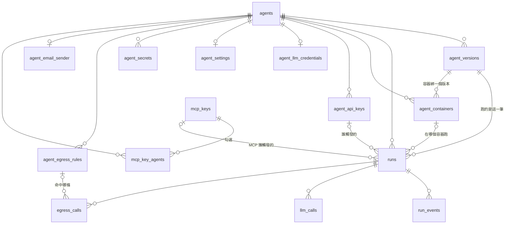

# PostgreSQL 資料庫

> **資料表結構的唯一事實來源是 `apps/api/migrations/NNNN_*.sql`**，不是這份文件，也不是任何 Python 檔。
> 這份文件說明每張表「為什麼長這樣」。落後於 migration 就是 bug，改 schema 時要一起改。
> 目前對齊 migration `0012`（0012 只刪資料：退休 builtin-echo）。

## 放什麼

**所有「事後需要查得到」的東西。**
Redis 只放會過期的東西（看 [redis.md](redis.md)）：Redis 整個清空會掉進行中的工作，但不會掉任何紀錄。

判斷新資料該放哪：它不見了，事後會不會有人問「那筆去哪了」？會 → PostgreSQL。

| 誰寫 | 寫什麼 |
|---|---|
| `app` | Agent、版本註冊、Run 建立；Gateway 收到的事件／結果／LLM 呼叫／對外請求稽核；憑證、設定、機密、各種 key |
| `worker` | 版本發布結果、Run 狀態轉移、常駐容器生命週期 |
| 容器 | **不能連**（網段沒有路由），一律經 `app` 的 `/internal/*` |

## 怎麼存取

- **純 SQL，沒有 ORM、沒有 Alembic。** `app` 用 asyncpg（連線池），`worker` 用 psycopg 3（每個 Celery 子行程一條連線）。
- 每一列的形狀定義在 `apps/api/rows.py`（dataclass + `COLUMNS`）。**rows.py 只描述欄位，不描述約束**；約束只寫在 `.sql`。
- 連線字串：`DATABASE_URL=postgresql://…@postgres:5432/zentra`（舊的 `+asyncpg` / `+psycopg` 前綴仍接受，啟動時會剝掉）。
- `pg_stat_activity.application_name`：`zentra-app` / `zentra-worker` / `zentra-migrate`。

### 連線借用規則（硬規則）

**連線只在「一個工作單元」（一段 `transaction()` / `connection()` 區塊）內借出；區塊內不准做任何 HTTP、DNS、SMTP、Redis、sleep、Docker API 呼叫。**

原因：抱著連線等外部 I/O，連線池很快就被吃光。

**寫法對照：**

```python
# ❌ 錯：抱著連線等 LLM
async with db.transaction() as conn:
    row = await conn.fetchrow(...)
    result = await call_llm(row)      # 這段可能等 30 秒
    await conn.execute(..., result)

# ✅ 對：讀完就放掉，做完外部呼叫再借一次
async with db.connection() as conn:
    row = await conn.fetchrow(...)
result = await call_llm(row)
async with db.transaction() as conn:
    await conn.execute(..., result)
```

正常情況下，下面這條查詢永遠是空的：

```sql
SELECT application_name, state, now() - xact_start FROM pg_stat_activity WHERE state = 'idle in transaction';
```

安全網：`zentra-app` / `zentra-worker` 連線設了 `idle_in_transaction_session_timeout = 60s`（`zentra-migrate` 不設）。
log 出現這個錯誤，代表有一處違反借用規則，**要修程式，不是把這個值調大。**
需要列鎖或 advisory lock 的函式，如果在交易外被呼叫會直接 raise（`require_transaction`）。

### Migration（改資料表結構）

- 執行：`make migrate`（= `docker compose exec -T app python -m apps.api.migrations`）。`app` / `worker` 啟動時**不會**自動 migrate。
- 每支 `.sql` 一個交易，**只有往前（up）**；要回退只能還原備份，或寫一支新的往前 migration。
- 版本表 `schema_migrations`（`version` 主鍵、`name`、`checksum` = 檔案位元組的 SHA-256、`applied_at`）。
  **已經套用過的 `.sql` 不得修改**，runner 比對 checksum 發現不同會拒絕。
- 多個 runner 同時跑，用 advisory lock（key `820020`）互斥。
- **改 schema 的順序：** 新增 `NNNN_<name>.sql` → `make migrate` → 同步 `rows.py` → 更新這份文件。
- 遺留：`alembic_version` 表（一列 `0008`）凍結保留，只給 `scripts/adopt-legacy-schema.sh`（把 ZEN-020 之前的庫接到 `schema_migrations`）用。之後有一支 migration 把它刪掉時，腳本要一起刪。

## 共通慣例

| 慣例 | 說明 |
|---|---|
| 主鍵用 UUID v7 | 由應用程式產生（`apps/api/ids.py::uuid7()`），資料庫沒有 default。依時間排序，cursor 分頁靠它。例外：`run_events.seq` 是 bigserial；`agent_llm_credentials` / `agent_settings` / `agent_email_sender` 以 `agent_id` 為主鍵；`agent_secrets` 是 `(agent_id, name)`；`mcp_key_agents` 是 `(mcp_key_id, agent_id)` |
| 時間用 `timestamptz` | 存 UTC。`created_at` 有 `DEFAULT now()` |
| 狀態欄用 `varchar + CHECK` | 不用 PG enum（要改值只要改 CHECK） |
| 彈性結構用 `jsonb` | `input` / `output` / `error` / `entrypoints` / `config` 的形狀由 API 規格定義 |
| 金額用 `numeric(12,6)` | 不用 float；API 輸出十進位字串 |
| 外鍵刪除行為是刻意選的 | 不是全部 CASCADE，看 §外鍵與刪除 |

## 表一覽

| 表 | 一列代表 | 數量級 |
|---|---|---|
| `agents` | 一個 Agent | 數十 |
| `agent_versions` | 一個版本（= 一個 image digest） | 每個 Agent 數個～數十 |
| `runs` | 一次呼叫 | **一直長** |
| `run_events` | Run 的一個事件 | **最大**，每個 Run 數十～數百 |
| `llm_calls` | 經過 Gateway 的一次 LLM 呼叫 | 每個 Run 0～數十 |
| `egress_calls` | 一次對外 HTTP 或寄信（含被擋的） | 依 Agent，可能每天上千 |
| `agent_llm_credentials` | 一個 Agent 的 LLM 金鑰 | 每個 Agent 0～1 |
| `agent_api_keys` | 一把下游 key（REST 用） | 每個 Agent 數把 |
| `mcp_keys` | 一把 MCP 接口的 key | 數把 |
| `mcp_key_agents` | 一把 MCP key 勾選了哪個 Agent | 每把 key 數個 |
| `agent_containers` | 一個常駐容器 | 每個版本 0～1 個在服務（歷史列會累積） |
| `agent_settings` | 一個 Agent 的設定文件 | 每個 Agent 0～1 |
| `agent_secrets` | 一個機密 | 每個 Agent ≤ 50 |
| `agent_egress_rules` | 一條對外白名單 | 每個 Agent ≤ 20 |
| `agent_email_sender` | 一個 Agent 的寄件者 | 每個 Agent 0～1 |



## 各表說明

「寫入者」標出哪個服務會改那一欄，方便追「這個值是誰寫壞的」。

### `agents`

| 欄位 | 型別 | 必填 | 說明 |
|---|---|---|---|
| `id` | uuid | ✅ | 主鍵 |
| `name` | varchar(255) | ✅ | **全表唯一**（`agents_name_key`），重複 → API `422` |
| `description` | text | | |
| `owner_id` | uuid | | 保留未用（單租戶，不做 RLS） |
| `created_at` / `updated_at` | timestamptz | ✅ | |
| `deleted_at` | timestamptz | | **遺留**。刪除已改成硬刪，不再寫入；查詢仍過濾 `deleted_at IS NULL`。舊的軟刪殘留列仍然佔著 `name` |

### `agent_versions`

**一筆紀錄的 digest 永不改寫**（P5）。同版號重新註冊 = 新增一筆，驗證通過後舊的改成 `SUPERSEDED`。

| 欄位 | 型別 | 必填 | 寫入者 | 說明 |
|---|---|---|---|---|
| `id` | uuid | ✅ | app | 主鍵，API 的 `agent_version_id` |
| `agent_id` | uuid | ✅ | app | FK → agents，CASCADE |
| `semver` | varchar(64) | ✅ | app | 同一個 `(agent_id, semver)` 可以有多列（現役 + 歷史） |
| `source_type` | varchar(16) | ✅ | app | 只能是 `OCI_IMAGE` |
| `image_ref` | text | ✅ | app | `<repository>@sha256:<64hex>`，**呼叫端送什麼字串就原封不動存** |
| `image_digest` | varchar(71) | ✅ | app | `sha256:<64hex>` |
| `version_id` | varchar(12) | ✅ | app | digest 前 12 個 hex，短顯示用 |
| `image_platform` / `image_size_bytes` / `runtime_contract` | | | worker | 驗證時從 image 讀出 |
| `manifest` / `entrypoints` | jsonb | | worker | 驗證時抽出。**entrypoints 是 REST 驗證、MCP、OpenAPI 的唯一 schema 來源** |
| `status` | varchar(16) | ✅ | app → worker | `BUILDING` → `PUBLISHED` / `FAILED`；`PUBLISHED` → `SUPERSEDED` |
| `error` | jsonb | | worker | `BUILD_FAILED`，附 `details.stage` |
| `validation_payload` | jsonb | | app | 驗證容器回寫的原始結果（用來做冪等比對） |
| `build_claimed_at` / `builder_task_id` | | | worker | 建置租約（10 分鐘） |
| `created_at` | timestamptz | ✅ | app | |
| `published_at` | timestamptz | | worker | |
| `superseded_at` | timestamptz | | worker | 被取代的時間 |

| 約束／索引 | 定義 |
|---|---|
| `uq_agent_versions_published_semver` | UNIQUE `(agent_id, semver) WHERE status = 'PUBLISHED'` —— 一個版號最多一筆現役 |
| `uq_agent_versions_building_semver` | UNIQUE `(agent_id, semver) WHERE status = 'BUILDING'` —— 同時只能一個在驗證（第二個 → API `409`） |
| `ck_agent_versions_status` | `IN ('BUILDING','PUBLISHED','FAILED','SUPERSEDED')` |
| `ck_agent_versions_digest` / `_version_id` | 格式檢查，擋住「只有 tag」進資料庫 |
| `ix_agent_versions_agent_status_created` | `(agent_id, status, created_at DESC)` |

### `runs`

| 欄位 | 型別 | 必填 | 寫入者 | 說明 |
|---|---|---|---|---|
| `id` | uuid | ✅ | app | 主鍵，就是 `run_id` |
| `agent_id` | uuid | ✅ | app | FK → agents，**沒有 CASCADE** |
| `agent_version_id` | uuid | | app | FK → agent_versions，**沒有 CASCADE**。建立時就決定好，之後不變（版本被取代也不影響） |
| `status` | varchar(16) | ✅ | app → worker | `QUEUED / SCHEDULING / RUNNING / SUCCEEDED / FAILED / CANCELLED` |
| `trigger` | varchar(16) | ✅ | app | `API` / `MCP`，由伺服器依入口寫入 |
| `entrypoint` | varchar(128) | ✅ | app | |
| `input` | jsonb | ✅ | app | 已通過 input_schema 驗證 |
| `output` / `error` | jsonb | | app / worker | |
| `usage` | jsonb | | app | 由 `llm_calls` 加總，不採信容器回報 |
| `timeout_seconds` | int | ✅ | app | 1～900 |
| `celery_task_id` | varchar(64) | | worker | |
| `sandbox_id` | varchar(80) | | worker | 一次性沙盒的 Docker id；常駐路徑為 NULL |
| `container_id` | uuid | | worker / app | FK → agent_containers，SET NULL。在哪個常駐容器跑；全滿排隊時是 NULL，被取走時補上 |
| `api_key_id` | uuid | | app | FK → agent_api_keys，SET NULL。REST 用量歸戶靠它 |
| `mcp_key_id` | uuid | | app | FK → mcp_keys，SET NULL。經 `/mcp` 建的 Run，記是哪把 MCP key |
| `result_received_at` | timestamptz | | app | 結果的冪等控制：已有值時，相同內容可重送，不同內容 → 422 |
| `created_at` / `started_at` / `finished_at` | timestamptz | | | |
| `owner_id`（varchar）、`session_id`（uuid） | | | | 保留未用。`owner_id` 的型別和 `agents.owner_id` 不一致，啟用前要先統一 |

- 約束：`ck_runs_status`、`ck_runs_trigger`（`API`,`MCP`）、`ck_runs_timeout`（1–900）。
- 索引：`ix_runs_agent_status_created (agent_id, status, created_at DESC)`、`ix_runs_api_key_created (api_key_id, created_at)`。
- **每次狀態轉移，和一列 `run_events(type='run.status')`，在同一個交易裡寫入。**

### `run_events`

事件的**持久化真相**；Redis Stream 只是通知。

| 欄位 | 型別 | 說明 |
|---|---|---|
| `seq` | bigserial 主鍵 | **全域遞增，就是 SSE 的 `id`**。用整數，因為 `Last-Event-ID` 要能比大小 |
| `run_id` | uuid | FK → runs，CASCADE |
| `event_id` | uuid | 容器產生，重送時沿用 |
| `type` | varchar(32) | `run.status / node.start / node.end / token / log / custom / error` |
| `payload` | jsonb | SSE 的 `data` |
| `ts` | timestamptz | |
| `terminal` | bool | 是不是終局的 `run.status` |
| `published_at` | timestamptz | 已 XADD 到 Redis 的時間；NULL = 待補送 |

約束：`uq_run_events_run_event (run_id, event_id)`（重送冪等）、`uq_run_events_terminal (run_id) WHERE terminal`（每個 Run 最多一個終局事件）。索引 `(run_id, seq)`。

### `llm_calls`

每一次 LLM 代打，**含失敗的**。是 LLM 用量的唯一真相。

欄位：`id` · `run_id`（CASCADE）· `model` · `input_tokens` · `output_tokens` · `cost_usd numeric(12,6)`（呼叫當下依 `LLM_PRICES` 算好，不回溯）· `latency_ms` · `status_code` · `error`（≤ 2000 字）· `credential_source`（`PLATFORM` / `AGENT`）· `created_at`。

索引 `(run_id, created_at)`。**沒有 `api_key_id`**：歸戶是 join `runs.api_key_id`，不存兩份（兩份會不一致）。

### `egress_calls`

對外 HTTP 和寄信共用一張表，用 `kind` 區分。**通過 token 驗證之後的每一次嘗試都寫**，包含被擋的和 422 的。

欄位：`call_id` 主鍵 · `run_id`（CASCADE）· `agent_id`（CASCADE）· `kind`（`HTTP` / `EMAIL`）· `rule_id`（→ agent_egress_rules，SET NULL）· `method` · `host` · `path`（**不含 query string**；EMAIL 時放收件人）· `status_code` · `request_bytes` · `response_bytes` · `latency_ms` · `error` · `created_at`。

索引：`(agent_id, created_at DESC)`（每小時寄信上限的計數靠它）、`(run_id)`（每個 Run 的次數上限靠它）。只增不刪。

### `agent_llm_credentials`

欄位：`agent_id` 主鍵/FK（CASCADE）· `ciphertext`（Fernet，用 `ZENTRA_SECRET_KEY`）· `last_four` · `base_url` · `default_model` · `created_at` · `updated_at`。
**沒有任何端點能讀出明文**，只有 Gateway 換金鑰時才解密。

### `agent_api_keys`

欄位：`id` 主鍵（就是 `key_id`）· `agent_id`（CASCADE）· `name` · `key_hash`（SHA-256 hex，**全表唯一**）· `key_prefix` · `created_at` · `last_used_at` · `revoked_at`（軟撤銷）。
**存雜湊，不是密文**：只需要驗證身分，資料庫外洩也還原不出 key。索引 `(agent_id)`。

### `mcp_keys` · `mcp_key_agents`

`mcp_keys`：`id` 主鍵（`key_id`）· `name` · `key_hash`（SHA-256 hex，**全表唯一**）· `key_prefix` · `created_at` · `last_used_at` · `revoked_at`（軟撤銷）。
**不綁 Agent**，所以沒有 `agent_id`。存雜湊的理由同 `agent_api_keys`。

`mcp_key_agents`：`(mcp_key_id, agent_id)` 複合主鍵 · `created_at`。兩邊的 FK 都是 CASCADE（Agent 被刪，勾選跟著消失；key 平常不會被硬刪，規則仍照寫）。索引 `(agent_id)`。

**例子：** 一把給 Dify 的 key 勾選了 stock-agent 和 echo-agent：

```
mcp_keys:        id=K1, name='Dify 正式環境'
mcp_key_agents:  (K1, stock-agent 的 id), (K1, echo-agent 的 id)
```

Console 改勾選 = 刪掉 K1 的所有列，再重新插入新的勾選（整份取代，在同一個交易裡）。

### `agent_containers`

| 欄位 | 型別 | 說明 |
|---|---|---|
| `id` | uuid 主鍵 | 平台自己的容器 id，重啟後不變 |
| `agent_id` | uuid | FK，CASCADE |
| `agent_version_id` | uuid | FK，**沒有 CASCADE**。容器只綁一個版本 |
| `container_id` | varchar(80) | **Docker 的** id，每次重建都會換 |
| `status` | varchar(16) | `STARTING / READY / UNHEALTHY / STOPPED / FAILED`。`UNHEALTHY` 只在存活檢查處理死掉的容器時短暫出現 |
| `inflight_runs` | int | 派進來還沒結束的 Run 數，`>= 0` |
| `started_at` / `last_health_at` | timestamptz | `last_health_at` = 最近一次長輪詢 |
| `restart_count` | int | `>= 0`，累計總數（手動與自動重啟都算） |
| `restart_window_started_at` | timestamptz | 自動重啟這一輪的起點。超過 10 分鐘就重新算 |
| `restarts_in_window` | int | 這一輪自動重啟了幾次，`>= 0`。`FAILED` 且 `>= 3` = 因為一直死掉而放棄，派工不再自動開常駐容器。手動重啟歸零 |
| `last_died_at` / `last_death_reason` | timestamptz / text | 存活檢查最後一次發現它死掉的時間與原因（exit code、OOMKilled、最後輸出）。重啟成功也保留 |
| `error` | text | FAILED 的原因（含容器輸出） |
| `created_at` | timestamptz | |

索引 `(agent_id, status)`。API 的 `max_concurrent_runs` 不在這張表裡，來自 `SANDBOX_RUNS_PER_CONTAINER`。

### `agent_settings` · `agent_secrets` · `agent_egress_rules` · `agent_email_sender`

| 表 | 欄位 | 約束／備註 |
|---|---|---|
| `agent_settings` | `agent_id` 主鍵 · `config jsonb DEFAULT '{}'` · 時間 | 明文，會進容器 |
| `agent_secrets` | `(agent_id, name)` 主鍵 · `ciphertext`（Fernet）· `last_four` · 時間 | 值永遠不進容器 |
| `agent_egress_rules` | `rule_id` 主鍵 · `agent_id` · `host` · `methods text[] DEFAULT {GET}` · `path_prefix` · `auth_secret_name` · `auth_header` · `description` · 時間 | UNIQUE `(agent_id, host)`；`auth_secret_name` 和 `auth_header` 要同時有或同時沒有；methods 1–2 個 |
| `agent_email_sender` | `agent_id` 主鍵 · `smtp_host` · `smtp_port` · `username` · `from_address` · `password_secret_name` · `allowed_recipients text[]` · 時間 | port ∈ {25, 465, 587}；收件人 1–10 個。**沒有密碼欄位** |

三種機密的處理方式並存，**不要統一**：
- `agent_secrets` 和 `agent_llm_credentials`：Fernet 密文（之後要解回來用）。
- `agent_api_keys` 和 `mcp_keys`：雜湊（只驗證身分）。

⚠️ 換掉 `ZENTRA_SECRET_KEY`，所有密文都解不開——備份時，金鑰要另外保管。

## 外鍵與刪除

| 子表.欄位 | → 父表 | ON DELETE | 為什麼 |
|---|---|---|---|
| 所有 `agent_*.agent_id`、`egress_calls.agent_id` | agents | CASCADE | 屬於 Agent，Agent 沒了它們也沒意義 |
| `runs.agent_id` | agents | **NO ACTION** | 有 Run 的 Agent 不能被順手刪掉 |
| `runs.agent_version_id`、`agent_containers.agent_version_id` | agent_versions | **NO ACTION** | 有東西在用的版本不能刪 |
| `runs.api_key_id`、`runs.mcp_key_id`、`runs.container_id` | agent_api_keys / mcp_keys / agent_containers | SET NULL | 那些東西沒了，Run 的歷史還是要留著 |
| `mcp_key_agents.agent_id`、`.mcp_key_id` | agents / mcp_keys | CASCADE | 勾選屬於兩邊 |
| `run_events` / `llm_calls` / `egress_calls` 的 `run_id` | runs | CASCADE | 屬於 Run |
| `egress_calls.rule_id` | agent_egress_rules | SET NULL | 規則刪了，稽核要留著 |

**刪 Agent**（`services/agents.py::delete_agent`）必須由下往上：
先收集容器 id 和 image_ref → 刪出口稽核、規則、寄件者、機密、設定 → 刪 `llm_calls` / `run_events` / `runs` → 刪 `agent_containers` → 刪 `agent_versions` → 刪 `agents`（憑證、key、MCP 勾選會 CASCADE）→ commit 之後，worker 清 Docker 和 registry。

## 典型查詢

| 情境 | 用到的索引 |
|---|---|
| 最新已發布版本（應用程式依 semver 取最大） | `ix_agent_versions_agent_status_created` |
| Runs 列表 | `ix_runs_agent_status_created` |
| SSE 續傳 `WHERE run_id = ? AND seq > ? ORDER BY seq LIMIT 200` | `(run_id, seq)` |
| 依 key 查用量 | `ix_runs_api_key_created` + `llm_calls (run_id, created_at)` |
| 驗證 API key | `agent_api_keys.key_hash` UNIQUE |
| 驗證 MCP key／取勾選 | `mcp_keys.key_hash` UNIQUE · `mcp_key_agents` 主鍵 |
| 挑可用的容器 | `(agent_id, status)` |
| 每小時寄信數 | `egress_calls (agent_id, created_at DESC)` |

## 維運

| 項目 | 現況 |
|---|---|
| 服務 | compose 的 `postgres`（`pgvector/pgvector:pg16`，擴充備而不用），只掛 `zentra-net`，volume `pgdata` |
| 備份 | **`pgdata` 和 `registrydata` 必須一起備份**；`ZENTRA_SECRET_KEY` 另外保管 |
| 成長 | `run_events` > `runs` ≈ `llm_calls`、`egress_calls`。沒有保留期限、沒有分區 |
| 連線數 | app `APP_WORKERS`（預設 2）× 15 + worker 10 + migration 1，要低於 `max_connections`（100） |
| 測試資料 | `make clean-test-data` 依名稱前綴清掉測試 Agent 與 Run；測試 Agent `probe-agent` 本身保留，它的 Run 與 API key 清掉 |
| ⚠️ 從主機連 | 主機上如果也有 Postgres 佔著 5432，會連錯庫。請在容器內跑：`docker compose exec postgres psql -U zentra -d zentra` |
